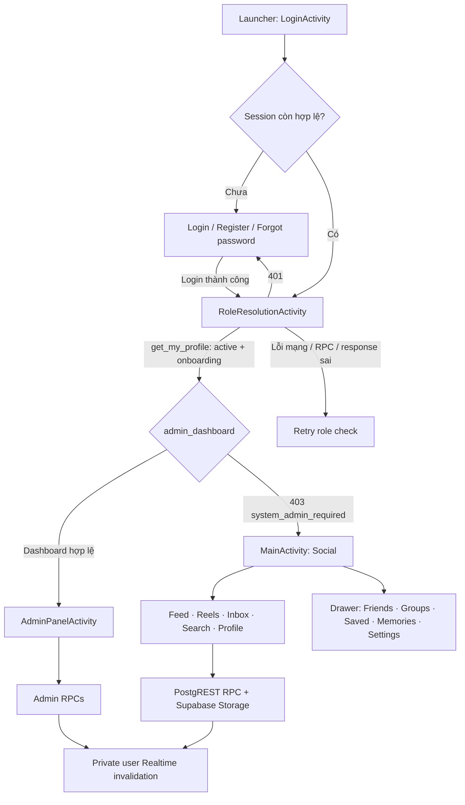

# Meeto — rà soát luồng hệ thống, nghiệp vụ và UX

**Workspace:** `D:\Android\MeetoMXH`  
**Application ID:** `com.example.meetomxh`  
**Nền tảng:** Android Java/XML  
**Backend trong source:** Supabase Auth, PostgREST RPC, Storage, Realtime và Edge Function  
**Ngày rà soát:** 2026-11-04

## Phạm vi và cách đọc kết quả

Đây là rà soát chỉ đọc source. Không chạy build/test, không mở emulator, không đăng nhập, không gọi Supabase Cloud, không triển khai migration và không sửa source. Tình trạng Cloud hiện tại không thể suy ra từ các file migration trong workspace.

Nhãn dùng trong tài liệu:

- **IMPLEMENTED:** Có đường xử lý trong source, không đồng nghĩa đã chạy thành công trên Cloud.
- **PARTIAL:** Có phần chính nhưng còn giới hạn nghiệp vụ, trạng thái hoặc kiểm chứng.
- **UI ONLY:** Chỉ xác nhận được phần giao diện, chưa tìm thấy đường nghiệp vụ đầy đủ.
- **NOT VERIFIED:** Chưa có bằng chứng runtime trong phiên rà soát này.
- **RUNTIME VERIFIED:** Đã quan sát trong các lượt emulator Task 32–34 trước đó; không phải kiểm thử mới hôm nay.
- **BLOCKED:** Cần Cloud, fixture, tài khoản hoặc thiết bị thứ hai để xác minh.
- **RISK:** Khả năng cần kiểm tra thêm, chưa phải lỗi tái hiện.

Đường dẫn bên dưới trỏ vào source hiện tại trong workspace. Các migration SQL được xem là định nghĩa/hợp đồng local; chưa xác nhận migration nào đã chạy trên Cloud.

## 1. Tổng quan hệ thống

Meeto là ứng dụng mạng xã hội Android có hai bề mặt riêng: Meeto Social cho người dùng thông thường và Dedicated Admin cho tài khoản có vai trò `system_admin`. Người dùng thường có Feed, Reels, Messenger, Search và Profile ở thanh điều hướng dưới; Friends, Groups, Saved Posts, Memories, Marketplace, Settings và Notifications được mở từ drawer, nút trên toolbar hoặc màn hình riêng.

Android chịu trách nhiệm giao diện, điều hướng, session cục bộ, tải media và gọi API. Supabase là nguồn dữ liệu và quyền truy cập. Hầu hết thao tác nghiệp vụ đi qua RPC PostgREST; media đi qua `SupabaseStorage` và các RPC chuẩn bị/finalize/authorize; realtime dùng một WebSocket private theo user để báo invalidate, sau đó repository tải lại dữ liệu.

## 2. Khởi động, xác thực và role routing

### Luồng

1. `AndroidManifest.xml` khai báo `LoginActivity` là `MAIN/LAUNCHER`; `RoleResolutionActivity` là Activity riêng và không export.
2. Khi người dùng đăng nhập, `SupabaseAuthClient.login()` gọi Supabase Auth password token endpoint, lưu session bằng `SessionManager.accept()` rồi gọi `bootstrap_profile`.
3. Login hoàn tất bằng cách mở `RoleResolutionActivity`, không mở trực tiếp Feed.
4. Role gate gọi `get_my_profile` qua `ProfileClient.self()`. Tài khoản bị khóa được đăng xuất; tài khoản chưa hoàn tất onboarding được đưa về đăng ký/onboarding.
5. `AdminRoleResolver.resolve()` gọi `admin_dashboard`. Phản hồi hợp lệ dẫn tới Admin; lỗi HTTP 403 với mã `system_admin_required` được hiểu là tài khoản Social; lỗi khác hoặc payload không hợp lệ hiện Retry.
6. Cả hai Activity đích nhận cờ role đã xác minh và xóa back stack. `MainActivity` tự chuyển lại role gate nếu được mở mà không có cờ xác minh.
7. Đăng xuất từ drawer/Admin xóa session và mở Login với `CLEAR_TASK`. Session refresh dùng refresh token; session generation làm mất hiệu lực callback cũ khi đổi tài khoản.

**Bằng chứng:** [AndroidManifest.xml](app/src/main/AndroidManifest.xml:21), [SupabaseAuthClient.java](app/src/main/java/com/example/meetomxh/supabase/SupabaseAuthClient.java:4), [SessionManager.java](app/src/main/java/com/example/meetomxh/supabase/SessionManager.java:22), [LoginActivity.java](app/src/main/java/com/example/meetomxh/LoginActivity.java:88), [RoleResolutionActivity.java](app/src/main/java/com/example/meetomxh/RoleResolutionActivity.java:86), [AdminRoleResolver.java](app/src/main/java/com/example/meetomxh/supabase/AdminRoleResolver.java:21), [MainActivity.java](app/src/main/java/com/example/meetomxh/MainActivity.java:37).

### Nhận xét

- **Source:** Admin không được tạo Social shell trong lúc role đang tải; role gate là màn hình trung gian trung tính. Lỗi xác minh không bị mặc định thành Regular User.
- **Source:** Đây là ứng dụng Android đơn, không có application thứ hai; Admin và Social là hai Activity shell trong cùng app.
- **Source:** Session refresh và dọn callback/cache theo generation đã có. Không thể xác nhận cấu hình TTL, refresh-token revocation hoặc role policy Cloud chỉ từ Android.
- **RUNTIME VERIFIED (Task 33 trước đây):** Trên Pixel_4, đăng nhập Admin mở thẳng Dashboard; tài khoản thường mở Social shell; logout/account switch và khôi phục session giữ đúng điểm đến; khi role check bị lỗi đã quan sát trạng thái Retry rồi phục hồi sau khi kết nối lại. Đây là kết quả lịch sử, không được chạy lại trong audit này.

## 3. Luồng người dùng thường

### 3.1 Home Feed và bài viết

`MainActivity` khởi đầu bằng `FeedFragment`; năm item ở bottom navigation là Feed, Reels, Messages, Search, Profile. Feed gọi `get_feed` theo cursor, mỗi trang 20 bài; pull-to-refresh reset cursor, load-more dùng cặp thời gian/ID. Fragment có shimmer, empty/error text và retry; thao tác đổi tab tạo fragment mới qua `replace`, do đó trạng thái view/scroll của tab trước không được giữ như một tab tồn tại lâu dài.

`FeedAdapter`/`PostAdapter` hiển thị card, tác giả, media, timestamp, reaction/comment/share/save/menu. Reaction đi qua `set_post_reaction`; comment qua `CommentClient`/RPCs; share mở `ShareActions`; save qua `set_saved_post`; chỉnh sửa/xóa dùng RPC có version. Avatar/tên tác giả mở Profile; media mở image/video viewer. UI cập nhật lại trang sau các action thành công.

**Bằng chứng:** [MainActivity.java](app/src/main/java/com/example/meetomxh/MainActivity.java:92), [bottom_nav_menu.xml](app/src/main/res/menu/bottom_nav_menu.xml:1), [FeedFragment.java](app/src/main/java/com/example/meetomxh/fragments/FeedFragment.java:42), [FeedRepository.java](app/src/main/java/com/example/meetomxh/repositories/FeedRepository.java:14), [FeedAdapter.java](app/src/main/java/com/example/meetomxh/adapters/FeedAdapter.java:1), [PostAdapter.java](app/src/main/java/com/example/meetomxh/adapters/PostAdapter.java:1), [ShareActions.java](app/src/main/java/com/example/meetomxh/supabase/ShareActions.java:45).

**Kết quả/runtime:** Feed reaction Like/Unlike, save/unsave, tạo bình luận và xóa bình luận của chính mình đã được quan sát trên Pixel_4 ở Task 34 trước đây. Bản xóa bình luận hiển thị thành nội dung đã xóa (soft delete). Không có bằng chứng runtime trong lượt audit hiện tại.

**UX/rủi ro:** `MainActivity.loadFragment()` thay fragment thay vì giữ nhiều fragment; khi quay lại tab, view được dựng lại và Feed refresh trong `onResume`. Điều này đơn giản hóa đồng bộ nhưng có thể làm mất vị trí cuộn/bản nháp; cần coi là UX trade-off, chưa phải lỗi dữ liệu. Trên lỗi mạng, Feed hiện status cùng thao tác chạm để retry; không có offline feed cache được xác nhận trong các đường code đã xem.

### 3.2 Tạo và quản lý bài viết

Từ nút composer trên toolbar hoặc Profile mở `CreatePostActivity`. Người dùng nhập caption, chọn media qua Android picker, chọn audience, tùy chọn mention/tag, xem preview rồi gửi. Ảnh/video được upload qua `SupabaseStorage`; khi có asset ID, Activity gọi `create_post_with_mentions` hoặc `create_community_post_with_mentions`. Sửa dùng `edit_post_with_mentions`; lỗi giữ nội dung trong Activity để thử lại. Request ID giúp giữ tính idempotent cho thao tác tạo.

Hậu quả dự kiến của thành công: RPC tạo post và liên kết media/metadata; quay về caller; Feed/Profile tải lại khi resume. Xóa post gọi `delete_post` với expected version. Source không khẳng định xóa post đồng nghĩa xóa media bytes ngay; media lifecycle có cleanup/retirement riêng.

**Bằng chứng:** [CreatePostActivity.java](app/src/main/java/com/example/meetomxh/CreatePostActivity.java:82), [CreatePostActivity.java](app/src/main/java/com/example/meetomxh/CreatePostActivity.java:196), [CreatePostActivity.java](app/src/main/java/com/example/meetomxh/CreatePostActivity.java:232), [FeedRepository.java](app/src/main/java/com/example/meetomxh/repositories/FeedRepository.java:37), [SupabaseStorage.java](app/src/main/java/com/example/meetomxh/storage/SupabaseStorage.java:349).

**Giới hạn:** Có thể chọn và xử lý ảnh/video, nhưng giới hạn cụ thể, codec và quota là server contract; không được suy ra mọi upload đều thành công. Flow group post có thể vào `pending_review`, tùy cấu hình nhóm; khi đó “đã gửi” chưa nhất thiết đồng nghĩa bài đã công khai.

### 3.3 Reels

Tab Reels dùng `ReelsFragment` cùng `ReelsRepository`, có chế độ Discover/Following, snap theo video, autoplay, mute, loading/error, like, follow và thao tác card. Tải danh sách qua `list_reels`. Media lấy metadata/authorized URL qua `SupabaseStorage.info`; player là ExoPlayer. Tạo Reel mở `CreateReelActivity`: video MP4, giới hạn cắt 1–60 giây, mute, caption/audience, tạo cover, upload video rồi cover, cuối cùng gọi `create_reel`. Request ID được giữ để retry; thành công invalidate cache.

**Bằng chứng:** [ReelsFragment.java](app/src/main/java/com/example/meetomxh/fragments/ReelsFragment.java:71), [ReelsFragment.java](app/src/main/java/com/example/meetomxh/fragments/ReelsFragment.java:78), [ReelsRepository.java](app/src/main/java/com/example/meetomxh/repositories/ReelsRepository.java:45), [CreateReelActivity.java](app/src/main/java/com/example/meetomxh/CreateReelActivity.java:49), [CreateReelActivity.java](app/src/main/java/com/example/meetomxh/CreateReelActivity.java:53), [CreateReelActivity.java](app/src/main/java/com/example/meetomxh/CreateReelActivity.java:58).

**RUNTIME VERIFIED (Task 32 trước đây):** Một fixture Reel nhỏ đã được tạo, phát và xóa trên Pixel_4; sau các thay đổi invalidation trước đó, danh sách sau xóa không còn Reel đó. Kết quả này chỉ bao phủ xem/xóa fixture, không xác nhận đủ Like/comment/share/save hoặc nhiều người dùng.

**PARTIAL:** Create Reel yêu cầu upload và xác minh phía Cloud; việc có source upload/`create_reel` không chứng minh Edge worker đã deploy hoặc xác minh video thành công. Cache là state trong tiến trình; lỗi xóa hay điều hướng giữa các entrypoint vẫn cần kiểm tra khi thay code liên quan.

### 3.4 Messenger và voice

Inbox mở từ tab Messages; hỗ trợ danh sách hội thoại, tìm hội thoại, tạo group chat, unread preview/badge. Mở chat gọi `get_conversation`, `get_conversation_members`, `get_messages`; pagination dựa sequence. Gửi text/media qua `send_message`, request ID và local `MessageOutbox` hỗ trợ retry. ChatActivity có reply, edit/revoke/message actions, search, shared media, report, controls mute/block, receipt/read/delivered và xử lý realtime invalidate. Share post vào chat đi qua `send_shared_post` và message có structured reference.

Voice source hỗ trợ record, preview, discard, upload và send, cùng playback bằng authenticated media loader. Source có UI xử lý tiến độ/retry, nhưng upload/finalize/verifier/worker phụ thuộc hợp đồng Cloud.

**Bằng chứng:** [InboxFragment.java](app/src/main/java/com/example/meetomxh/fragments/InboxFragment.java:67), [ChatRepository.java](app/src/main/java/com/example/meetomxh/repositories/ChatRepository.java:18), [ChatRepository.java](app/src/main/java/com/example/meetomxh/repositories/ChatRepository.java:44), [MessageOutbox.java](app/src/main/java/com/example/meetomxh/supabase/MessageOutbox.java:9), [ChatActivity.java](app/src/main/java/com/example/meetomxh/ChatActivity.java:324), [ChatActivity.java](app/src/main/java/com/example/meetomxh/ChatActivity.java:577), [ChatActivity.java](app/src/main/java/com/example/meetomxh/ChatActivity.java:733), [ChatActivity.java](app/src/main/java/com/example/meetomxh/ChatActivity.java:802), [ShareActions.java](app/src/main/java/com/example/meetomxh/supabase/ShareActions.java:66).

**Realtime:** [RealtimeClient.java](app/src/main/java/com/example/meetomxh/supabase/RealtimeClient.java:17) join private topic theo UID; server broadcast invalidate làm các observer fetch lại, có heartbeat và retry backoff. [Observer.java](app/src/main/java/com/example/meetomxh/supabase/Observer.java:7) còn polling 30 giây làm fallback. Vì vậy realtime là tín hiệu làm mới, không phải đồng bộ đầy đủ từng row độc lập.

**RUNTIME VERIFIED (Task 34 trước đây):** Hai tài khoản thường được dùng tuần tự trên cùng Pixel_4 trong một conversation thử nghiệm: A gửi text, B nhìn thấy preview/unread và mở chat; B trả lời, A nhìn thấy khi mở lại và receipt/read cập nhật. Không phải test realtime đồng thời trên hai thiết bị.

**BLOCKED / lỗi đã thấy (Task 34 trước đây):** Voice recording và preview hoạt động sau quyền microphone; upload dừng ở gần 99% rồi thất bại sau retry finalize. Không có voice message được tạo/nhận/phát; HTTP/PostgREST code cụ thể và tình trạng worker Cloud chưa được xác nhận. Do đó voice end-to-end chưa hoàn tất.

### 3.5 Search và Explore

Search tab có tìm người/bài viết và nội dung Explore; Advanced Search repository dùng RPC people/posts/history; nhóm có RPC riêng trong Groups. Kết quả người mở Profile, bài mở post detail/card; việc tìm kiếm nhạy với quyền xem ở RPC backend. Lịch sử search được lưu riêng cho người dùng.

**Bằng chứng:** [SearchFragment.java](app/src/main/java/com/example/meetomxh/fragments/SearchFragment.java:96), [SearchFragment.java](app/src/main/java/com/example/meetomxh/fragments/SearchFragment.java:134), [AdvancedSearchRepository.java](app/src/main/java/com/example/meetomxh/repositories/AdvancedSearchRepository.java:32), [CommunityGroupRepository.java](app/src/main/java/com/example/meetomxh/repositories/CommunityGroupRepository.java:18).

**PARTIAL:** Code và RPC call tồn tại; chưa có runtime audit cho mọi query/filter, pagination, privacy/block combination và migration hiện được triển khai. Không coi “có danh sách RPC trong migration local” là xác nhận Search Cloud hoạt động.

### 3.6 Profile và social graph

Profile load hồ sơ, bài viết, follow/friend relationship, counts, featured/pinned content, albums/photos, story entrypoint và action buttons. Theo dõi/bỏ theo dõi gọi `set_follow`; friend request là flow riêng (`send_friend_request`, accept/decline/cancel/unfriend). Message mở hoặc tạo hội thoại riêng. Block gọi `set_block`; danh sách blocked users ở Settings. Profile timeline có like/comment/share/save/delete và load-more.

**Bằng chứng:** [ProfileActivity.java](app/src/main/java/com/example/meetomxh/ProfileActivity.java:142), [ProfileActivity.java](app/src/main/java/com/example/meetomxh/ProfileActivity.java:433), [ProfileActivity.java](app/src/main/java/com/example/meetomxh/ProfileActivity.java:584), [ProfileActivity.java](app/src/main/java/com/example/meetomxh/ProfileActivity.java:596), [ProfileActivity.java](app/src/main/java/com/example/meetomxh/ProfileActivity.java:711), [ProfileAlbumsActivity.java](app/src/main/java/com/example/meetomxh/ProfileAlbumsActivity.java:64), [FriendRepository.java](app/src/main/java/com/example/meetomxh/repositories/FriendRepository.java:14).

**UX/logic:** Friendship và follow là hai quan hệ riêng, nhưng tên nút/counter cần nhất quán để người dùng hiểu khác biệt. ProfileActivity bao phủ nhiều action và phụ thuộc nhiều callback; lỗi ảnh/avatar hoặc phần featured có thể bị ẩn bằng fallback, nên cần tránh diễn giải “không hiện” thành “không có dữ liệu”.

### 3.7 Notifications

NotificationsActivity có filter all/unread, pagination, mark-one/read-all, retry state, click-to-navigate. NotificationRepository gọi `get_notifications`, unread count, mark read và settings. Trên toolbar/drawer có đường mở. Loại notification được map sang nội dung và đích như Profile, Post hoặc Chat.

**Bằng chứng:** [NotificationsActivity.java](app/src/main/java/com/example/meetomxh/NotificationsActivity.java:59), [NotificationsActivity.java](app/src/main/java/com/example/meetomxh/NotificationsActivity.java:85), [NotificationsActivity.java](app/src/main/java/com/example/meetomxh/NotificationsActivity.java:92), [NotificationRepository.java](app/src/main/java/com/example/meetomxh/repositories/NotificationRepository.java:11), [NotificationItem.java](app/src/main/java/com/example/meetomxh/models/NotificationItem.java:1).

**RUNTIME VERIFIED (Task 34 trước đây):** Notification message mở đúng Chat; lỗi label generic đã được sửa trong source Task 34, sau cài bản sửa notification hiển thị tên người gửi/nội dung đã được map. Chưa kiểm chứng tất cả loại notification, push khi app bị đóng hoặc mọi đích Post/Group/Moderation.

### 3.8 Stories

Story ring nằm trong Feed card; tạo story mở StoryCreateActivity, chọn ảnh/video, chọn audience, upload, gọi `create_story`. StoryViewActivity lấy danh sách bằng `get_stories`, gọi `mark_story_viewed`, cho xem viewer với story của mình, reply bằng `reply_to_story`, xóa story riêng. Video mở player riêng; timer/paused lifecycle điều khiển chuyển story.

**Bằng chứng:** [StoryAdapter.java](app/src/main/java/com/example/meetomxh/adapters/StoryAdapter.java:1), [StoryCreateActivity.java](app/src/main/java/com/example/meetomxh/StoryCreateActivity.java:30), [StoryClient.java](app/src/main/java/com/example/meetomxh/supabase/StoryClient.java:13), [StoryClient.java](app/src/main/java/com/example/meetomxh/supabase/StoryClient.java:28), [StoryViewActivity.java](app/src/main/java/com/example/meetomxh/StoryViewActivity.java:38), [StoryViewActivity.java](app/src/main/java/com/example/meetomxh/StoryViewActivity.java:53), [StoryViewActivity.java](app/src/main/java/com/example/meetomxh/StoryViewActivity.java:61).

**RUNTIME VERIFIED (Task 34 trước đây):** Story fixture ảnh/video nhỏ đã tạo và xem; caption/author đúng. Có race khi xóa story video do timer mở player chồng lên confirm dialog; source hiện pause/cancel pending launch lúc dialog mở. Sau sửa, dialog giữ foreground và fixture bị xóa thành công. Reply, viewer privacy và các quyền audience chưa được runtime kiểm tra.

### 3.9 Groups

GroupsHomeActivity có My Groups/Discover, search debounce, create, invites, detail. Repository gọi `search_community_groups`/`search_advanced_groups`; màn group/detail có thành viên, bài viết, moderation và invite actions. Group post dùng luồng composer/repository chung nhưng audience group và có thể vào pending approval. Việc post pending không nên được hiểu là công khai cho tất cả thành viên cho tới khi duyệt.

**Bằng chứng:** [GroupsHomeActivity.java](app/src/main/java/com/example/meetomxh/GroupsHomeActivity.java:36), [GroupsHomeActivity.java](app/src/main/java/com/example/meetomxh/GroupsHomeActivity.java:62), [CommunityGroupRepository.java](app/src/main/java/com/example/meetomxh/repositories/CommunityGroupRepository.java:18), [CreatePostActivity.java](app/src/main/java/com/example/meetomxh/CreatePostActivity.java:247).

**RUNTIME VERIFIED (Task 34 trước đây):** Groups Home tải được empty state “chưa tham gia nhóm”; không có group fixture nên chưa tạo hoặc kiểm thử member/admin/approval flows. Đây là PARTIAL, không phải xác nhận nhóm lỗi.

## 4. Dedicated Admin

AdminPanelActivity là shell riêng với các section tổng quan, người dùng, nội dung, báo cáo, audit và settings. Màn hình xác minh quyền trước khi tải section; có loading, error/retry, search debounce, pagination, claim report, report detail, moderation action, suspend/restore và logout. Admin không dùng Feed hoặc bottom navigation Social.

| Section | RPC/source path | Mục đích |
|---|---|---|
| Dashboard | `admin_dashboard` — `AdminPanelActivity.load()` | Thống kê, báo cáo gần đây, hành động gần đây |
| User search | `admin_search_users` | Search và page người dùng |
| Content moderation | `admin_list_content`, `admin_moderate_content` | Tìm, lọc, hide/restore/remove nội dung |
| Reports | `list_platform_reports`, `claim_platform_report`, `admin_report_detail`, quyết định xử lý | Claim và giải quyết report |
| Audit | `admin_audit_page` | Đọc lịch sử thao tác quản trị |
| Settings | `renderSettings()` | Cài đặt giao diện/tuỳ chọn Admin trong app |

**Bằng chứng:** [AdminPanelActivity.java](app/src/main/java/com/example/meetomxh/AdminPanelActivity.java:51), [AdminPanelActivity.java](app/src/main/java/com/example/meetomxh/AdminPanelActivity.java:87), [AdminPanelActivity.java](app/src/main/java/com/example/meetomxh/AdminPanelActivity.java:162), [AdminPanelActivity.java](app/src/main/java/com/example/meetomxh/AdminPanelActivity.java:172), [AdminPanelActivity.java](app/src/main/java/com/example/meetomxh/AdminPanelActivity.java:272), [AdminPanelActivity.java](app/src/main/java/com/example/meetomxh/AdminPanelActivity.java:302), [AdminPanelActivity.java](app/src/main/java/com/example/meetomxh/AdminPanelActivity.java:317), [AdminPanelActivity.java](app/src/main/java/com/example/meetomxh/AdminPanelActivity.java:344).

**RUNTIME VERIFIED (Task 33 trước đây):** Admin Dashboard, search users, reports, content list, audit empty state, loading/error handling, navigation/back và theme selector đã mở trên Pixel_4. User search gọi RPC thành công khi kiểm thử; deployment provenance của migration 036/repair chưa được xác minh độc lập. Reports/Audit có thể rỗng theo dữ liệu, không đồng nghĩa lỗi.

**Giới hạn:** Không kiểm thử moderation có side effect lên tài khoản/nội dung thật trong phạm vi Task 33/34; không kết luận từng action Cloud. Menu role resolution dựa vào authorization của `admin_dashboard`, vì vậy RPC permission/configuration là dependency quyết định cả route Admin/User.

## 5. Kiến trúc kỹ thuật và dữ liệu

### Android client

- Activities/Fragments dựng giao diện và chuyển màn hình; adapters map model sang card/list.
- Repositories gom gọi RPC, cursor, state và callback; một số màn hình (đặc biệt Profile/Chat/Admin) vẫn có RPC điều phối ngay tại Activity.
- `Api.run()` chạy I/O nền, trả callback về main thread và bỏ callback thuộc session generation cũ.
- `RpcClient` gọi `/rest/v1/rpc/<function>` qua authorized HTTP client; `SupabaseAuthClient` dùng `/auth/v1`; session được giữ bằng encrypted vault.

**Bằng chứng:** [Api.java](app/src/main/java/com/example/meetomxh/supabase/Api.java:14), [RpcClient.java](app/src/main/java/com/example/meetomxh/supabase/RpcClient.java:4), [SupabaseHttpClient.java](app/src/main/java/com/example/meetomxh/supabase/SupabaseHttpClient.java:17), [EncryptedVault.java](app/src/main/java/com/example/meetomxh/supabase/EncryptedVault.java:1).

### Supabase, quyền và realtime

- RPC là lớp nghiệp vụ chính; migration định nghĩa `private.*` SECURITY DEFINER và public wrapper SECURITY INVOKER, nhưng quyền thực tế phụ thuộc migration đã triển khai, grants và JWT role hiện hành.
- `RealtimeClient` subscribe private user topic; event invalidation khiến observer refetch. `Observer` polling định kỳ làm fallback.
- Không có căn cứ trong audit này để xác nhận tenant, RLS, trigger, cron, outbox dispatcher hoặc Edge Function đang đúng trạng thái trên Cloud.

### Media/storage/background

Upload đi qua helper upload intent/direct storage và finalize trong `SupabaseStorage`; metadata/RPC resolve asset; `PrivateAssetLoader` tải media có authorization. Feed/Reels/Stories/Chat/Profile albums đều tham chiếu asset IDs; xóa nội dung không nhất thiết xóa bytes ngay, vì retirement và background cleanup tách biệt. Voice verifier cần worker, signed/authorized download và finish/finalize flow; source không chứng minh worker Cloud đang chạy.

**Bằng chứng:** [SupabaseStorage.java](app/src/main/java/com/example/meetomxh/storage/SupabaseStorage.java:1), [PrivateAssetLoader.java](app/src/main/java/com/example/meetomxh/storage/PrivateAssetLoader.java:1), [CreateReelActivity.java](app/src/main/java/com/example/meetomxh/CreateReelActivity.java:55), [ChatActivity.java](app/src/main/java/com/example/meetomxh/ChatActivity.java:743).

## 6. Cross-module flow matrix

| Luồng | Điểm vào → xử lý → kết quả | Trạng thái / bằng chứng |
|---|---|---|
| Login → Social | Login → role gate/profile → admin_dashboard trả 403 admin-required → MainActivity/Feed | IMPLEMENTED; RUNTIME VERIFIED Task 33; Cloud contract hiện thời chưa audit |
| Login → Admin | Login/session restore → role gate → admin_dashboard hợp lệ → AdminPanelActivity | IMPLEMENTED; RUNTIME VERIFIED Task 33 |
| Feed → Profile → Follow | Post author → ProfileActivity → `set_follow` hoặc friend action → update button/count | IMPLEMENTED; code path; chưa có E2E mới |
| Feed → Comment | Post action → bottom sheet → CommentClient RPC → list/update/delete | IMPLEMENTED; Like/Comment/Delete runtime Task 34 |
| Feed → Share → Chat | `ShareActions` → select chat → `send_shared_post` → structured post message | IMPLEMENTED; source only, runtime share chưa xác nhận |
| Reel → Chat | Share action với post/reel source → `send_shared_post`/chat flow tùy model | PARTIAL; chưa xác minh Reel share contract/runtime đầy đủ |
| Search → Profile/Message | Search result → Profile; Profile message button → `get_or_create_private` → ChatActivity | IMPLEMENTED; chưa E2E mới |
| Notification → Chat | mark-read → `NotificationItem` mapping → ChatActivity | RUNTIME VERIFIED Task 34 cho message notification |
| Notification → Post/Profile | mark-read → type-based navigation | IMPLEMENTED; từng notification type chưa runtime kiểm tra |
| Profile → Post → Media | Profile timeline → PostAdapter/details → authorized media viewer | IMPLEMENTED; runtime chưa bao phủ mọi media/private audience |
| Profile → Reel → viewer | Profile/Reels card → ExoPlayer; delete invalidates cache | PARTIAL; Reel create/play/delete fixture Task 32 đã verified |
| Story → Profile/Reply | Story view → author Profile/viewers/reply-to-chat | PARTIAL; create/view/delete verified; reply chưa test |
| Group → Post | Group detail → composer → create group post; optional approval | PARTIAL; chưa có test group fixture |
| Create Post → Feed/Profile | composer upload → create RPC → finish → parent refresh | IMPLEMENTED; test thao tác Feed riêng đã verified |
| Delete Post → Feed/Profile/Search | `delete_post` → Feed refresh; other screens refresh on lifecycle | PARTIAL; đồng bộ giữa các screen phụ thuộc refetch/invalidation |
| Delete Reel → Profile/Reels | delete RPC → invalidate `ReelsRepository` → reload | RUNTIME VERIFIED Task 32 với fixture |
| Block → Search/Profile/Chat | `set_block`/list blocked; backend gate expected to enforce all reads/sends | PARTIAL; chưa matrix kiểm tra Cloud authorization |
| Chat → Shared Post → Post detail | Message DTO carries shared post → `PostDetails.show(get_post)` | IMPLEMENTED; preview unavailable fallback exists; runtime chưa kiểm |
| Admin hide/suspend → Social | Admin action RPC → server-side state/privacy changes → Social refetch | PARTIAL; chưa thao tác trên dữ liệu thật |
| Logout → account switch | Clear session/generation/cache → Login → role gate | RUNTIME VERIFIED Task 33; Task34 test sessions were regular users |
| Session restore → role | Launcher checks saved user → gate → role resolution | IMPLEMENTED; runtime Task 33 verified both roles |

## 7. Tình trạng chức năng

| Chức năng | Đánh giá source | Runtime evidence | Giới hạn đáng chú ý |
|---|---|---|---|
| Auth, session, role routing | IMPLEMENTED | RUNTIME VERIFIED Task 33 | Refresh/security state Cloud chưa xác minh hôm nay |
| Feed, pull refresh, pagination, cards | IMPLEMENTED | PARTIAL runtime Task 34 | Không có offline feed; tab replace có thể mất scroll |
| Post create/edit/delete/media | IMPLEMENTED | PARTIAL | Từng nhánh privacy/group approval và upload chưa E2E hết |
| Reaction/comment/save/share | IMPLEMENTED | Like/comment/save runtime; share chưa | Cross-screen freshness chủ yếu refetch lifecycle |
| Reels view/create/delete | IMPLEMENTED | Fixture create/play/delete Task 32 | Interaction matrix và worker Cloud chưa đủ |
| Messenger text/media | IMPLEMENTED | Two-account tuần tự Task 34 | Realtime đồng thời trên 2 client chưa xác nhận |
| Messenger voice | PARTIAL | Recording/preview only; send/playback BLOCKED | Upload/finalize/verifier Cloud failure trước đây |
| Stories | IMPLEMENTED | Create/view/delete Task 34 | Reply/viewer/policy chưa E2E |
| Search/history | IMPLEMENTED | Admin user search only in Task 33 | Social filters/privacy Cloud chưa xác minh |
| Profile/follow/friends/block | IMPLEMENTED | Chưa có E2E đầy đủ Task 34 | Follow và friendship là hai graph riêng |
| Notifications | IMPLEMENTED | Message click-through Task 34 | Push/background delivery và mọi kinds chưa test |
| Groups | PARTIAL | Empty state Task 34 | Không có fixture cho member/post approval/admin |
| Admin dashboard/user/report/moderation/audit | IMPLEMENTED | Nhiều màn hình Task 33 | Không chạy side-effect action trên dữ liệu thật |
| Albums/Memories/Marketplace | PARTIAL | Chưa runtime trong Task 34 | Source/RPC có nhưng Cloud/deployment và UX chưa xác nhận |

## 8. Phát hiện và điểm cần xem xét

### MEDIUM — voice send chưa hoàn tất ở runtime

Đã quan sát upload voice ở gần 99% rồi đi vào lỗi sau retry; không phát sinh tin nhắn thoại có thể nhận/phát. Đây là blocker thực tế cho demo voice, nhưng chưa đủ thông tin xác định có phải client, verifier deployment, cron/worker, RPC hay Cloud configuration. Cần giữ trạng thái **PARTIAL/BLOCKED**, không sửa Android hoặc backend chỉ dựa trên triệu chứng cũ.

### MEDIUM — tab navigation dựng lại Fragment

`MainActivity.loadFragment()` dùng `replace` và Feed refresh ở `onResume`. Khi quay lại tab, scroll/fragment-local state có thể khởi tạo lại. Đây là quan sát source về UX, không phải lỗi runtime đã xác nhận; quyết định xem cần giữ scroll/draft là product choice.

### MEDIUM — phần lớn freshness dựa trên invalidate + refetch

Realtime không truyền projection đầy đủ; subscriber refetch, cộng polling 30 giây. Điều này đơn giản và giảm đồng bộ client phức tạp, nhưng có thể tạo độ trễ hoặc tải RPC khi nhiều observer/tab cùng hoạt động. Cần quan sát tải/độ trễ thực trước khi tối ưu.

### HIGH RISK — migration/Edge Function drift giữa workspace và Cloud

Workspace có migration tới 036 và Edge Function audio cleanup/verifier, nhưng file local không chứng minh đã deploy theo đúng thứ tự hoặc Cloud schema đang ở revision nào. Admin Search, Reels, Voice, tags/albums và một số RPC mới sẽ phụ thuộc điều này. Trước demo, owner cần đối chiếu migration history, function deployment/version, cron jobs và grants ở Supabase Dashboard. Không deploy trong audit.

### MEDIUM RISK — hành vi media sau xóa

Các feature gọi delete content rồi invalidate/refetch; cleanup bytes là lifecycle riêng. Nếu UI cache hoặc signed URL còn sống, có thể thấy media tạm thời sau xóa. Reel fixture trước đây đã biến mất sau refresh, nhưng điều đó không xác nhận mọi caller (Feed/Profile/Search/Albums/Chat) hoặc cleanup vật lý.

### MEDIUM RISK — security phụ thuộc server policy

Android gọi RPC được xác thực, nhưng không phải ranh giới quyền. Block, audience, group membership, report detail, shared posts, mentions/tags và private media phải được kiểm tra ở function/RLS/Storage policy trên Cloud. Source Android chỉ gửi UID/ID và hiển thị response; không chứng minh server đang chạy migrations hiện tại.

### LOW/MEDIUM — relationship wording

Friend request/accept và Follow/Unfollow là hai workflow riêng. UI cần dùng tên/count rõ để người dùng không hiểu “bạn bè” và “đang theo dõi” là cùng một quan hệ. Đây là câu hỏi UX, không phải bug backend đã xác nhận.

## 9. Câu hỏi cần Project Owner quyết định

1. Voice messaging có phải điều kiện demo bắt buộc? Nếu có, cần ưu tiên truy nguyên HTTP/PostgREST error và worker/verifier runtime trước khi tuyên bố sẵn sàng.
2. Khi chuyển tab, sản phẩm có yêu cầu giữ nguyên vị trí cuộn, query và bản nháp hay chấp nhận refresh tab?
3. Group post chờ duyệt có nên hiển thị cho tác giả, moderator và thành viên khác theo chính sách nào? UI nên nói rõ trạng thái pending.
4. Follow và friendship có tiếp tục là hai quan hệ độc lập không; dùng wording/count nào trong Profile?
5. Trước demo, ai sẽ xác nhận migration 036, các migration liên quan media/Reels/voice và Edge Function đã deploy đúng Cloud project?
6. Marketplace, Memories, Albums, story reply, Reels reactions/comments/shares và push notification có nằm trong phạm vi demo hay chỉ là phần đã phát triển?

## 10. Kết luận

Meeto hiện có cấu trúc Android–Supabase khá rõ: auth/role gate tách Admin và Social; Social có các shell Feed, Reels, Inbox, Search, Profile; thao tác nghiệp vụ chủ yếu đi qua RPC; media và realtime có lớp client riêng. Những luồng đã quan sát trước đây gồm role routing, các thao tác Feed cơ bản, Reel fixture, Stories tạo/xem/xóa, message notification click-through và text chat hai tài khoản theo lượt.

Hệ thống chưa thể được gọi là E2E hoàn chỉnh chỉ từ source. Voice send đã thất bại ở runtime trước đây; group/action combinations, nhiều nhánh notification, cross-screen media invalidation và server-side privacy chưa được kiểm chứng đầy đủ. Rủi ro lớn nhất trước khi mở rộng tính năng là không biết chắc migration/Edge Function nào đang chạy trên Cloud. Nên ưu tiên xác minh trạng thái Cloud và chốt voice demo, sau đó mới lên kế hoạch phát triển tiếp.

**Kết quả audit:** source reviewed; không chạy build/test, không dùng emulator hoặc Cloud trong lượt này; không thay đổi source. File này là báo cáo duy nhất được tạo theo yêu cầu.
