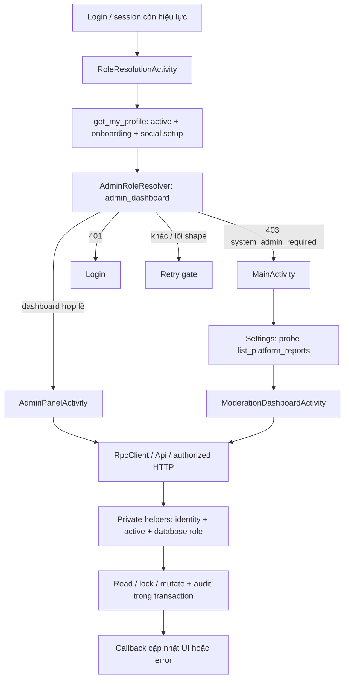

# MEETO — Task 54A: Admin Center audit và redesign blueprint

Ngày: **07/11/2026, Asia/Bangkok**. Workspace: `F:\MeetoMXH`. **AUDIT ONLY — chưa triển khai 54B/54C/54D.**

## 1. Executive summary

Meeto có nền tảng Admin thật để tái sử dụng: dashboard lấy số liệu database, tìm tài khoản, danh sách Post/Reel/Comment, báo cáo có assignment, thao tác trực tiếp có request ID, audit và server role gates. Không cần xây lại từ đầu. Tuy nhiên, **chưa đủ bằng chứng để xác nhận demo-ready hoặc security/runtime PASS**: không truy cập Cloud, build, test, emulator hay ghi dữ liệu.

Ưu tiên 54B trước khi thay UI: tách xem/claim/decision; thống nhất state transition và audit giữa xử lý từ report với xử lý trực tiếp; ổn định request ID ở Android; hoàn thiện quyền/bằng chứng của Moderator; chuẩn hóa permission/error contract. Sau đó 54C mới thay navigation và detail screens. Giữ nguyên Music Task 52 và Comment tree Task 53.

Các phát hiện đáng chú ý đã xác nhận **từ source**:

- Admin Panel mở report chưa gán sẽ tự claim; chỉ xem cũng thay đổi workflow.
- Moderator backend có thể hide/remove report target thuộc phạm vi được gán, nhưng màn Moderator chỉ cung cấp warn/dismiss và không mở evidence detail/media.
- Hai đường remove Post có hành vi khác: direct Admin retire media/xóa body/điều chỉnh share count; report decision chỉ đổi state/version/deleted_at.
- Audit projection không trả actor/action/report ID; report suspend và remove Story/Message không ghi đủ old/new state thực tế.
- Không tìm thấy emission/trigger notification kết quả cho các RPC moderation hiện hành. Có enum moderation không đồng nghĩa đã thông báo.
- XML `activity_moderation_dashboard.xml` là **UI ONLY, không được Activity inflate**; Activity thật dùng `Forms.start`.
- Community Groups đã bị retire bằng REVOKE và một số guard PT410. Không đưa tính năng này trở lại chỉ vì schema/function cũ còn tồn tại.

### Quy ước đánh giá

`IMPLEMENTED` = có đường Android → RPC → SQL xác định trong source; **không** đồng nghĩa hoạt động trên Cloud. `COMPLETE` chỉ đủ phần contract đang xét ở source. `PARTIAL`, `UI ONLY`, `BACKEND ONLY`, `MISSING`, `RISKY` mô tả gap; **mọi chức năng đều UNVERIFIED ở runtime**. “Lỗi xác nhận” dưới đây chỉ lỗi/mismatch chứng minh được từ code; hậu quả bảo mật hoặc race trên Cloud chưa tái hiện được được ghi riêng là rủi ro.

## 2. Kiến trúc Admin hiện tại

Admin role không đọc từ Intent hoặc raw user metadata: resolver gọi RPC được server bảo vệ. Intent `role_verified_by_server` chỉ là shortcut navigation của social shell, không phải quyền SQL. `AdminPanelActivity` kiểm lại khi resume, từng RPC vẫn tự kiểm role. Moderator đi qua social Settings, không được resolver đưa vào Admin Panel.

`RpcClient` gửi POST tới wrapper public; các read RPC mang STABLE, các mutate mặc định VOLATILE. Wrapper SECURITY INVOKER, implementation private SECURITY DEFINER `search_path=''`. `Api` có job/session generation và chặn callback sau đổi identity; `SupabaseHttpClient` refresh/retry một lần khi 401. Không quy kết các màn Admin là hoàn toàn thiếu session isolation: helper chung đã có bảo vệ này.

`SocialContract.required()` bỏ probe capability với `admin_*`, nhưng `list/claim/resolve_platform_report` vẫn yêu cầu capability Task 36. Vì vậy dashboard có thể mở trong khi Report Center bị chặn do Cloud contract chưa đạt. Đây là dependency cần hiển thị riêng, không đổi thành bypass role gate.

## 3. Inventory Android và bằng chứng

| Thành phần | Vai trò / bằng chứng chính | Đánh giá |
|---|---|---|
| `AdminPanelActivity.java` (~400 dòng) | Dashboard, account search/action, reports/detail/media/decisions, Post/Reel/Comment actions, audit, settings trong một Activity; `load` :169+, `openReport` :305+ | IMPLEMENTED/PARTIAL; monolith render + network + state + mutations |
| `ModerationDashboardActivity.java` :20–115 | Forms queue, claim, warn/dismiss, 50 audit rows; không paging | IMPLEMENTED/PARTIAL; trùng report workflow |
| `AdminRoleResolver.java` :21–56 | Gọi admin_dashboard làm role probe, kiểm shape JSON, phân biệt 401/403/lỗi | IMPLEMENTED; chưa có capability nhẹ/capability theo Moderator |
| `RoleResolutionActivity.java` :97–171 | Active/onboarding gate → resolver → Admin/social/retry/login | IMPLEMENTED; social setup vẫn áp trước phân nhánh Admin |
| `ReportContentActivity.java` :35–65 | Report typed target, reason/details, stable RequestIds; nhánh legacy group report | IMPLEMENTED; không có impersonation radio dù RPC hỗ trợ |
| `SettingsActivity.java` :46–52 | Ẩn moderation row rồi probe list_platform_reports(limit=1); success mới hiện | IMPLEMENTED; lỗi mạng giống không có quyền |
| `activity_admin_panel.xml`, `admin_menu.xml` | Material toolbar, bốn nút tab ngang, search, status, ScrollView + LinearLayout, pull-refresh, load more, logout | IMPLEMENTED; không RecyclerView/selected-state navigation |
| `activity_moderation_dashboard.xml` | Chips, banner “sẵn sàng kết nối API”, empty queue tĩnh | UI ONLY/không được sử dụng; không phải bằng chứng màn chạy có mock data |
| `Forms.java`, `activity_form.xml` | UI thực của Moderator, action button và formStatus | REUSE được một phần; thay list layout trong 54C |
| `VideoPlayerActivity`, `ChatImageViewerActivity` | Admin report detail mở media qua `asset://`; video có load/error/retry/lifecycle | IMPLEMENTED; media quyền vẫn qua Storage/RLS |
| `Api`, `RpcClient`, `SupabaseHttpClient`, `ErrorMapper`, `SessionManager` | Session-bound async, JWT refresh, sanitized diagnostic; Admin không có client riêng | REUSE; cần typed Admin errors/lifecycle ownership |

**Số màn:** 2 Activity thực hiện quản trị; 1 Activity gate; 1 Activity user gửi report hỗ trợ workflow. Settings là entry point, media viewers dùng chung; không tìm thấy Admin Fragment/adapter chuyên biệt đang được các màn trên sử dụng. Manifest khai báo Admin/Moderator/RoleResolution `exported=false`; ẩn entry point không thay thế SQL authorization.

Report entry points đã đối chiếu: Feed Post → `ReportContentActivity` target post; Reel dùng cùng canonical Post; Story viewer → story; Comment bottom sheet → comment. Report submit dùng readable-target checks ở server. Không tìm thấy dữ liệu dashboard fake trong đường thực; formatter `optLong(...,0)` có thể biến field thiếu thành số 0, là rủi ro contract chứ không phải mock data.

## 4. Inventory PostgreSQL / RPC / RLS / roles

### 4.1 Định nghĩa cuối cùng trong migration local

Đã tìm các CREATE/CREATE OR REPLACE theo thứ tự tên migration và kiểm các override/REVOKE động; không kết luận từ migration gốc. Tiền tố đường dẫn SQL trong bảng: `supabase/migrations/`.

| Public RPC → private implementation, signature | Định nghĩa private cuối | Android / quyền |
|---|---|---|
| `admin_dashboard()` | `20261104000100_admin_panel.sql:34` | Resolver + Admin dashboard; system_admin |
| `admin_search_users(text,timestamptz,uuid,int)` | `20261104000200_admin_search_users_readonly_fix.sql:21` | Account search; system_admin |
| `admin_list_content(text,text,text,timestamptz,uuid,int)` | `20261106000300_notifications_moderation.sql:98` | Posts/Reels/Comments; system_admin; groups PT410 |
| `admin_moderate_content(text,uuid,text,text,uuid)` | cùng file :145 | hide/remove/restore; system_admin; group PT410 |
| `admin_set_account_status(uuid,text,text,uuid)` | `20261104000100_admin_panel.sql:200` | suspend/restore; system_admin |
| `admin_report_detail(uuid)` | `20261106000400_group_chat_avatar.sql:43` | Admin dùng; Moderator chưa dùng; system_admin hoặc assigned moderator |
| `admin_audit_page(timestamptz,uuid,int)` | `20261104000100_admin_panel.sql:275` | Admin audit có cursor; system_admin |
| `submit_content_report(text,uuid,text,text,uuid)` | `20261103000700_account_privacy_moderation.sql:80` | User report readable target; active writer |
| `list_platform_reports(text,timestamptz,uuid,int)` | cùng file :126 | Cả hai màn/Settings probe; Admin hoặc Moderator scoped |
| `claim_platform_report(uuid)` | cùng file :151 | Cả hai màn; Admin hoặc Moderator |
| `resolve_platform_report(uuid,text,text)` | `20261106000300_notifications_moderation.sql:49` | Cả hai màn; action/target/assignment gate |
| `get_platform_audit(int)` | `20261103000700_account_privacy_moderation.sql:195` | Moderator; Admin cũng được; không cursor |

Tất cả read RPC trên: STABLE; mutate: VOLATILE. Public wrappers của admin tạo ở `20261104000100`, report wrappers ở `20261103000700`, không bị thay signature bởi override private sau. User-search fix đã bỏ `b_actor()` khỏi STABLE function: **đã sửa trong source**, không đưa lỗi cũ thành bug hiện tại.

Helper closure cần giữ: `require_identity`, `account_ok`, `is_active`, `has_role`, `lock_profile`, `b_actor`, `b_active`, `b_page`, `can_review_report`, `can_review_report_media`, `can_read_media`, `can_read_object`, readable target helpers, `retire_asset`, `schedule_media_cleanup`. `b_actor` ở `20261101000400_social.sql:4` lấy advisory transaction lock toàn cục 6061101 và `lock_profile`; `b_active` chỉ đọc identity/active. Read guard không lấy writer lock. `has_role`/`can_review_report` cuối ở `20261101000200_authorization.sql:27/:121`; report-media/media authorization cuối ở `20261106000400:18/:29`.

Historical group RPC: `report_group_target`, `list_group_reports`, `resolve_group_report` ở `20261103000600`, nhưng `20261106000100_follow_only_privacy.sql:701` REVOKE `%group%` không chứa `%conversation%` khỏi PUBLIC/anon/authenticated. Những function lịch sử được tạo lại sau đó phải kiểm từng grant; không suy ra community group workflow hiện khả dụng. Chat `manage_conversation_member`, `set_conversation_avatar` là quyền nhóm chat, **khác platform Moderator**; `20261101001500_chat_upload_admin_safety.sql` bảo vệ last chat admin/upload, không cấp platform admin role.

### 4.2 Tables, constraints, indexes, triggers

| Nhóm dữ liệu | Hợp đồng hiện có |
|---|---|
| `system_roles` | `(user_id,role)` PK, role chỉ system_admin/moderator, granted_by/timestamp; không có role user trong bảng, không có RPC Admin cấp role |
| `reports` | Typed FKs post/comment/story/message/profile/group, ON DELETE SET NULL; target có thể không còn; check tối đa 1 FK, không bắt buộc còn đúng 1; reporter/assigned_to cũng nullable; state open/assigned/resolved/dismissed; reason 1–50, details <=3000 ở table; unique(reporter_id,client_request_id) |
| `moderation_actions` | actor/request unique; action hide/remove/restore/warn/suspend/unsuspend/dismiss; reason 1–3000; report_id đã nullable từ Admin migration; FK report RESTRICT |
| `moderation_audit` | actor/action/report refs, operation, subject_type/id, safe_metadata object, timestamp; không request_id trực tiếp; reason/state nằm trong JSON; không cột result/failure |
| `account_status` | active/suspended/deleting, suspended_until, deletion_requested_at; writer chỉ nhận active |
| `appeals` | Table + state open/reviewing/accepted/rejected, role-scoped policy nhưng không có client table grant/workflow RPC/UI hoàn chỉnh; chưa đưa vào scope demo bắt buộc |
| Content/media | profiles, posts, comments, stories, groups, messages, post_media/message_media/media_assets; case review không tạo copy bằng chứng riêng |
| Notifications/operations | notifications, user_settings, event_outbox; có generic emit/realtime/cleanup infrastructure, chưa có moderation-result workflow nối vào |

Indexes source: reports_assignment_idx(assigned_to,state,created_at,id), reports_reporter_idx, reports_post_idx, reports_message_idx; historical reports_group_lookup_idx; moderation_actions_case_idx; moderation_audit_case_idx/actor_idx; profiles/posts/comments/groups_admin_page_idx(created_at DESC,id DESC); moderation_audit_admin_page_idx. PK/unique indexes bảo vệ role, report request và action request. Chưa thấy index riêng tối ưu global reports(state,created_at DESC,id DESC) hoặc text substring search; chỉ là nhu cầu xem query plan, không kết luận query chậm khi chưa đo.

Triggers liên quan: bootstrap identity/account; user_settings_touch; historical group_role_audit, group_request_audit, group_post_audit; comment parent trigger Task53 chỉ trên INSERT; notification consent triggers cho follow/message request/chat invitation. **Không tìm thấy trigger claim audit, system_roles audit, hoặc moderation-action/result notification; không có trigger cấm UPDATE/DELETE moderation_audit với owner.** Group post state trigger có thể tạo thêm event audit khi group_id còn tồn tại, không phải hai lần cùng action.

### 4.3 RLS và grants

`system_roles`, `reports`, `moderation_actions`, `moderation_audit`, `appeals` bật RLS. Các policy SELECT khai báo: role của chính mình; report/action theo can_review_report; audit toàn bộ cho Admin hoặc report được Moderator review; appeals theo appellant/assignee/Admin. Tuy nhiên authorization migration cuối cùng **REVOKE table privileges** khỏi PUBLIC/anon/authenticated: policy tồn tại không có nghĩa Android được SELECT. Quyền thực tế ứng dụng đi qua RPC. Không có DML grants cho client trên role/report/audit/account_status; account_status SELECT chỉ chính mình.

Admin/report public và private entry functions REVOKE PUBLIC/anon/service_role rồi GRANT EXECUTE authenticated trong migration tương ứng. Vì wrapper invoker gọi private implementation nên private RPC entry helpers cần EXECUTE authenticated; private schema không nên expose ở PostgREST. Server role checks vẫn là rào chắn với mọi authenticated user. Helpers nội bộ nhạy cảm như can_review_report_media đã revoke trực tiếp; can_read_media SECURITY DEFINER gọi chúng bằng owner.

`media_assets_select` được GRANT SELECT authenticated và RLS dùng can_read_media; Storage authenticated GET dùng can_read_object→can_read_media. `Dto.asset`/SupabaseStorage.info→media_assets→Storage GET giữ tuyến này. Chỉ ready media mới đi qua nhánh case review. Không đổi bucket thành public hay dùng service_role để mở preview.

Owner phải xác minh live ACL, function owner/BYPASSRLS, private schema exposure, migration ledger và trigger drift bằng file preflight; source không chứng minh catalog Cloud giống local.

## 5. Ma trận chức năng hiện tại

| Chức năng | Source status | Giới hạn chính |
|---|---|---|
| Admin role server gate / active checks | COMPLETE ở contract source | Role probe dùng dashboard nặng; Cloud/runtime UNVERIFIED |
| Moderator route | PARTIAL | Qua Settings/social, không có shell/capability riêng |
| Dashboard thật | IMPLEMENTED/PARTIAL | Counts DB; thiếu mới theo ngày/my work, dùng 0 fallback khi field thiếu |
| User search + cursor + debounce | IMPLEMENTED | Tên substring/UID chính xác; 350 ms, 30 rows; không state filter/username/email search |
| User Detail / violation history | PARTIAL/MISSING | AlertDialog chỉ UID/state/is_system_admin; không history/content/reports links |
| Suspend/restore account | IMPLEMENTED/RISKY UX | Lý do, server self/admin protection; không thời hạn dù label khóa tạm thời |
| Report submit / idempotent request | IMPLEMENTED | Readable target, reason allowlist, 24h dedupe; không snapshot evidence |
| Report queue/filter/paging | PARTIAL | Admin có cursor, open gộp assigned; thiếu dedicated assigned/type/date; search report không gửi query vào RPC |
| Claim | IMPLEMENTED/RISKY UX | Atomic/same-actor replay; Admin tự claim khi mở; không release/reassign/audit claim |
| Report detail/evidence | PARTIAL | Admin có target/media, Moderator không gọi; message body chỉ placeholder; Story caption bị UI bỏ sót |
| Resolve report | IMPLEMENTED/PARTIAL | Backend 5 actions; Moderator UI 2; state/audit/remove semantics cần thống nhất |
| Post/Reel/Comment direct moderation | IMPLEMENTED/PARTIAL | List/search/cursor/actions; không content detail/media/context đầy đủ |
| Story direct management | MISSING | Chỉ xử lý qua report, không list/restore contract |
| Community Groups | RETIRED, lịch sử BACKEND ONLY | Không tái kích hoạt ở 54C |
| Music provenance / Comment tree in Admin | MISSING projection/UI | Shared MP4 vẫn có thể preview; chưa có metadata/parent tree context |
| Audit list | PARTIAL | Server ghi events, UI raw JSON; API thiếu actor/action/report links |
| Moderation notifications | MISSING workflow | Generic kind/helper tồn tại, không có call/trigger kết quả |
| Dedicated moderation XML | UI ONLY | Không dùng ở màn runtime |
| Admin settings | IMPLEMENTED nhỏ | Email phiên/version/logout; không fake switch cho backend chưa hỗ trợ |

## 6. Phân quyền và bảo mật

| Quyền | System Admin active/onboarded | Moderator active/onboarded | User thường / suspended / chưa onboard |
|---|---|---|---|
| Mở Admin Panel / đọc dashboard | Có, server check | Không; resolver đưa social | User không; inactive bị active guard từ chối |
| Queue reports | Toàn bộ | Unassigned open/assigned + assigned cho mình | Không |
| Target ID/details chưa claim | Có | Redacted nếu chưa assigned mình | Không |
| Claim report | Có nếu chưa gán; replay khi assigned mình | Tương tự | Không |
| Report detail / reported private media | Toàn bộ report-scoped | Chỉ report assigned mình | Không có privilege review; quyền social thông thường độc lập |
| Warn/dismiss/hide/remove qua report | Có theo target support/protected owner | Có ở server cho assigned report; UI chỉ warn/dismiss | Không |
| Suspend qua report | Chỉ Admin | Không | Không |
| Direct account/content management | Có; self/system-admin target bị bảo vệ | Không | Không |
| Audit | Tất cả qua admin_audit_page/get_platform_audit | Report audit được can_review_report cho phép | Không |
| Role assignment | Không có Android/RPC product flow | Không | Không |

Suspended/deleting/chưa onboarded không được privileged RPC dù vẫn có system_roles row/JWT còn hạn. `is_active` kiểm account state, onboarding và email/phone confirmation; mutate lock_profile còn yêu cầu email confirmed. Cần quyết định nếu hỗ trợ phone-only admin vì read/write guards hiện khác điều kiện xác minh, không coi đó là exploit đã xác nhận.

Không tìm thấy đường cho user thường nâng role qua Android; helper đọc system_roles từ DB, không trust client actor. Admin/moderator biết tên RPC có thể gửi HTTP tới endpoint được EXECUTE authenticated, nhưng body phải từ chối khi thiếu app role. “Có thể gọi HTTP” khác “được thực hiện action”. Cần kiểm live grant/owner; không khẳng định tuyệt đối không có IDOR chỉ bằng static audit.

**Private messages:** admin_report_detail không trả message body hoặc cả conversation; chỉ placeholder. can_read_message vẫn đòi membership/history/hidden-message checks, không có global admin bypass. can_review_report_media chỉ mở attachment liên kết tới report target post/story/message; Moderator cần assignment, Admin cần tồn tại một report liên quan. Không cấp quyền đọc toàn bộ chat. Tuy nhiên helper không giới hạn open/resolved hoặc thời gian retention, nên media report đã đóng vẫn có thể review nếu asset ready. Đây là policy/retention cần owner duyệt, chưa phải xác nhận lộ media không liên quan.

**Revocation/session:** Admin resume reverify role và RPC kiểm role mỗi call; Api epoch chặn callback sau logout/đổi tài khoản, HTTP refresh một lần. Admin Activity không giữ Subscription/lifecycle cancellation cho mọi request và thiếu generation theo màn/filter; callback từ Activity cũ vẫn có rủi ro nếu chỉ đổi lifecycle mà không đổi account. Role thay giữa transaction không có hệ thống capability version/revocation lock riêng; không hứa hủy transaction đã được authorize trước khi revoke. Đề xuất clear dữ liệu nhạy cảm và re-resolve khi 403/inactive.

Không tìm thấy service_role literal/reference trong Android source đã rà; SupabaseConfig dùng BuildConfig.SUPABASE_ANON_KEY và user Bearer. **Chưa kiểm actual build secrets/APK**: tên biến anon không chứng minh giá trị cấu hình đúng. Không in token/key vào report/preflight. Diagnostic HTTP chỉ log stage/status/safe machine code, không raw body/JWT; JSON audit reason vẫn có thể chứa dữ liệu do Admin tự nhập nên cần giới hạn và hướng dẫn nội dung.

## 7. Vòng đời báo cáo

1. User chọn reason/details. Platform: spam/harassment/inappropriate/impersonation/misinformation/other; UI ánh xạ radio violence thành inappropriate, chưa có impersonation radio. Platform details <=1000; legacy group <=3000, reason violence riêng. Table reason chỉ check length, không enum chung.
2. submit_content_report lấy active actor, validate typed readable target (profile không được chính mình), stable request tuple; duplicate cùng reporter/target/reason trong 24h open/assigned trả case cũ. Không gửi reporter identity trong admin queue JSON.
3. list_platform_reports dùng cursor (created_at,id), limit 1–50; p_state=open bao gồm assigned. Moderator chỉ thấy unassigned summary hoặc cases của mình. Reports riêng của reporter chưa có status/history endpoint.
4. claim dùng UPDATE có điều kiện assigned_to IS NULL + state open/assigned; concurrent claimant một người thắng, người khác PT409. Cùng actor claim lại assigned case trả thành công. Không có release/reassign; revoked assignee có thể khiến case bị kẹt tới thao tác operator/contract mới.
5. Admin Panel openReport tự claim trước fetch detail nếu assigned_to null. Moderator có nút Nhận xử lý riêng nhưng sau claim vào thẳng dialog decision, không tải target evidence. Đây là hai UX không thống nhất.
6. resolve lấy writer guard và FOR UPDATE report, yêu cầu assignment cho Moderator; Admin có thể xử lý report người khác gán mà không overwrite assignee. Target bị lock theo loại. Backend hiện hỗ trợ dismiss/warn/hide/remove/suspend; group non-dismiss trả feature_retired.
7. Terminal decision lặp cùng actor/action/reason trả kết quả cũ; tuple khác PT409. INSERT action, UPDATE report, INSERT audit và target update cùng transaction: exception rollback, không có “report resolved nhưng audit insert thất bại vẫn commit” trong source contract.
8. Không có bước notification kết quả được nối vào. “Warn” hiện là action/audit, chưa phải cảnh cáo đã tới người dùng.

**Edge cases:** reporter bị suspend không làm mất case; reviewer vẫn xử lý được. Owner thay trạng thái được đọc/lock lúc resolve, suspend chỉ active→suspended. Post/comment deleted bị chặn hide/remove; Story/message remove không kiểm rowcount nên có thể ghi decision khi target FK đã null/mất. Warn với target mất cũng chưa có branch giải thích; dismiss vẫn cần để đóng case. Hard delete target SET NULL bảo toàn report nhưng mất canonical target ID gốc; chưa có snapshot/tombstone evidence ổn định. Không có FK constraint state↔assigned_to/resolved_at chặt chẽ, phải inventory dữ liệu thực.

**Nhiều reports cùng target:** hiện giữ từng report và action riêng, không grouping. Không auto resolve/deduplicate toàn bộ để tránh mất lịch sử. 54B nên nhóm chỉ ở projection/UI (target type/id), serialize target action, lưu một canonical action và liên kết decision từng case trong transaction rõ ràng; case chưa được review không tự đóng. Report-target missing dùng reference lưu bền hoặc snapshot tối thiểu theo policy, không thu thập cả chat.

## 8. Quản lý tài khoản

Search đúng theo source: lower(display_name) LIKE substring, UID canonical exact; không username/email/UID prefix. Cursor đúng shape user_id, 30 dòng, debounce 350ms; thiếu filter active/suspended/deleting và search length client <=100. `admin_search_users` trả account_state/suspended_until/is_system_admin, không đầy đủ Moderator roles/onboarding/deletion request/violation history. Không phát hiện fake user rows.

Action direct cần reason trim 1–1000, request_id, actor active/admin; chặn tự khóa, chặn đổi trạng thái mọi system_admin (cả restore), active→suspended hoặc suspended→active; deleting không restore. UI vẫn có thể hiện Mở khóa cho state deleting/protected account rồi server từ chối, thiếu disabled reason. Dialog lý do tự dismiss khi nhập trống, người dùng phải mở lại. Refresh sau thành công có resetPage ở runAction, nhưng response replay không được UI diễn giải riêng.

“Khóa tạm thời” thực chất khóa đến khi Admin restore: direct RPC set suspended_until=NULL; không có duration input hoặc tác vụ tự hết hạn trong source. Report suspend không chuẩn hóa suspended_until như direct. Không đề xuất sửa auth.users trực tiếp từ Android. Đề xuất User Detail dùng public business state/roles allowed; không trả email/auth metadata/số điện thoại mặc định. Màn detail phải có trạng thái, action hợp lệ, reason/history, related reports/content được server scope; cần endpoint mới, không cho Android tự query toàn database.

## 9. Quản lý nội dung

| Loại | List/search/filter/detail/media hiện tại | Hide / remove / restore | History/notification |
|---|---|---|---|
| Post | Admin list body/author/state/cursor; p_state backend nhưng UI gửi null; không media/detail ở list. Report detail có body+ready media | Direct đủ 3; report hide/remove; không restore deleted | Audit có, chưa link subject; notification chưa nối |
| Reel | Cùng posts theo is_reel, report target_kind=post; shared video viewer | Theo canonical Post như trên | Music metadata không nằm admin projection; MP4 đã mix vẫn là media |
| Story ảnh/video | Không direct list/search; report detail có caption/media, UI summary không đọc caption | Chỉ report remove; không hide/restore contract | Audit state thiếu; không result notification; expired không bằng deleted |
| Comment tree | Flat list có post_id nhưng thiếu parent/root/display depth; report detail body/post_id | Direct hide/remove/restore; report hide/remove; counts update trong RPC | Task53 promote descendants khi ancestor hidden/deleted; Admin chưa thể hiện tác động tới thread |
| Community Group | Historical schema/functions, entry points revoked; current admin_list groups/direct group PT410 | Không coi historical actions là feature khả dụng | Audit lịch sử còn; không bật lại trong roadmap mặc định |
| Profile violation | Account search + report target display_name/account_state; không media profile trong report media helper | Warn/dismiss hoặc Admin suspend; không generic hide/remove profile | Không có violation-history User Detail; warning delivery thiếu |
| Reported message | Không global list/search; target placeholder; report-associated ready attachment nếu quyền review | Report remove→removed; không hide/restore hoặc whole-chat read | Chưa có scoped text-evidence endpoint; không result notification |

**State machines thực:** Post/Reel = published/pending_review/rejected/hidden/deleted (pending/rejected từ historical group migration, không được xóa khỏi audit chỉ vì Groups retire). Comment = published/hidden/deleted; Story = active/archived/deleted, còn expires_at là điều kiện độc lập; Community Group = active/archived/deleted; Message = sent/recalled/removed; Account = active/suspended/deleting. Không đồng nhất archived với hidden, rejected với deleted, hoặc expired Story với moderation remove.

Direct restore chỉ hidden/archived theo generic code; thực tế các loại direct đang cho phép chỉ Post/Reel/Comment nên restore hidden→published, không nhận Story; deleted/rejected không restore. Direct remove xóa body/retire Post media; report remove hiện giữ Post body/media reference. Phải thống nhất policy giữ bằng chứng trước khi chọn cách cleanup, không đơn giản copy direct remove vào report mà làm mất evidence.

Task52/53: giữ metadata/music hash, canonical Reel/Post ID, media ACL và comment parent/tombstone semantics. Admin không nên tải Openverse để review nhạc hoặc gọi list_comment_tree như quyền bypass. Đề xuất projection moderation riêng trả music attribution an toàn và thread ancestry tối thiểu trong scope case; không mở rộng ACL social projection.

## 10. Audit, notifications và operations

Direct action: actor_id/action_id/subject type/id/timestamp được lưu; old/new state/reason trong safe_metadata; request ID ở moderation_actions. Report decision cũng có action/report link nhưng client không gửi stable action request ID (server gen_random_uuid); terminal tuple replay giảm trùng. **Claim không có audit record**, không có platform role-change audit trigger/RPC flow. Log không có failure attempt/result column; exception rollback không thể vừa rollback decision vừa giữ row failure trong cùng transaction. Tách security/operational attempt telemetry khỏi committed moderation history.

Projection admin_audit_page/get_platform_audit/recent_actions bỏ actor_id/action_id/report_id/client_request_id dù table có một phần các dữ liệu đó. Android hiện render operation/subject_type/time và raw safe_metadata; không link report/target hoặc actor. Report suspend audit old_state có thể là state Post/Comment thay vì account state; new_state không gán. Story/message remove không gán new_state, profile warning cũng không có delivery evidence.

Audit **append-only đối với client** vì không DML grants/RPC; không phải tamper-proof đối với database owner/service jobs. Không có immutable trigger; actor/action/report FKs SET NULL có thể đổi reference khi xóa thực thể. Không log message body/JWT trong safe_metadata hiện có; reason là free text, có thể chứa PII. Nên giới hạn schema metadata theo operation, UI format có kiểm soát và policy retention/redaction thay vì dump JSON.

Không thấy các moderation RPC gọi emit_notification hoặc event_outbox, và không trigger trên moderation_actions/reports/account_status để gửi kết quả. Generic emit_notification insert notification/realtime invalidate có dedupe recipient+event_key, lọc recipient active/onboarded/settings/block; **không bảo đảm gửi tới tài khoản vừa suspended**. Khi bổ sung cần notification/notice policy riêng cho xử lý tài khoản và quyền xem quyết định khi không active; không mở toàn social app cho suspended user. Nếu cần delivery bất đồng bộ, ghi decision + durable event cùng transaction, worker dùng event/action ID chống trùng và theo dõi pending/delivered/failed; notification DB committed không đồng nghĩa push đã tới máy. Không thêm Edge Function/proxy hoặc dịch vụ mới chỉ để đủ checklist; tái sử dụng hạ tầng outbox nếu owner xác nhận có worker vận hành.

## 11. Lỗi/mismatch xác nhận từ source

| ID | Bằng chứng | Kết luận có thể khẳng định |
|---|---|---|
| F01 | AdminPanelActivity.openReport :305–313 | Mở case chưa gán gây mutation claim trước khi xem |
| F02 | ModerationDashboardActivity.moderate vs resolve_platform_report 060003:53+ | UI Moderator chỉ warn/dismiss; quyền backend có thêm hide/remove theo assignment; không fetch evidence detail |
| F03 | AdminPanelActivity.renderRows/searchable/load | Search hiện trong Báo cáo nhưng RPC không có p_query; UI thiếu queue assigned riêng, open thực gộp assigned |
| F04 | admin_moderate_content vs resolve_platform_report, cùng 060003 | Post remove khác cleanup/body/share-count semantics theo entry point |
| F05 | resolve_platform_report 060003:70–91 | Audit old/new account/Story/message chưa đầy đủ; Story/message missing-target UPDATE không check rowcount |
| F06 | AdminPanelActivity.confirmAccount/runAction, UUID.randomUUID | Mỗi lần confirm tạo request mới; không giữ stable identity cho retry khi response thất lạc |
| F07 | AdminPanelActivity.reportDecision/claim error gọi load(false), load dùng requestedAfterTime hiện tại | Reload thay thế sau decision có thể dùng cursor trang cuối, bỏ qua trang đầu; runAction direct lại reset đúng |
| F08 | Admin audit projections; Android renderAudit | Không thể hiển thị actor và liên kết action/report chỉ bằng JSON trả hiện tại |
| F09 | AdminPanelActivity.load success, nhánh rows.length()>0 | LoadMore chỉ cập nhật visibility khi page không rỗng; append nhận [] không ẩn nút/cập nhật cursor, có thể tiếp tục gửi cùng trang cuối |
| F10 | ErrorMapper.message:403/410 branches trước serverMessage-specific branches | 403 đổi thành lỗi media chung, handlePermissionError tìm chuỗi 403/system_admin_required thường không khớp; 410 feature_retired bị mô tả như upload expired |
| F11 | Source role/audit/report migrations và search call/trigger | Chưa nối notification moderation results; claim chưa có audit; không tuyên bố warn đã gửi |
| F12 | account RPC :236 và UI label | Khóa “tạm thời” không có thời hạn/tự phục hồi |
| F13 | showReportDetail đọc body/name/display_name/preview | Story target.caption không được dùng; có thể hiện không còn khả dụng dù caption/media vẫn tồn tại |

Các F trên không phải kết quả chạy app/SQL. Màn Moderator giữ bốn button cố định bằng removeViews(4,...); với source hiện tại đây không phải lỗi off-by-one. XML moderation không được dùng nên không lấy empty state tĩnh trong XML để kết luận queue thật luôn rỗng.

## 12. Rủi ro chưa xác nhận / không nên gọi bug đã khai thác

- Cloud thiếu migration, live role grants/owner/private exposure khác source; chỉ preflight mới đối chiếu được.
- Case media không giới hạn thời hạn/terminal state; policy retention có thể quá rộng. Chưa thấy truy cập được attachment không có report liên quan.
- Stale callbacks sau Activity destroy/filter change, UI dữ liệu cũ sau role revoke; Api epoch đã giảm rủi ro đổi account. Chưa tái hiện cross-account display.
- Hai decision khác report cùng target, retry mất response, cleanup worker chạy khi evidence còn cần giữ; DB locks serialize writes nhưng không có shared decision/version contract cho tất cả đường vào.
- Global writer advisory lock và COUNT dashboard/substring search có thể tắc khi tải lớn; chưa có benchmark/EXPLAIN, không gọi là bottleneck đã xác nhận.
- Metadata field thiếu hiện số 0, JSON cast ở callback và body/details nullable có thể hiển thị sai hoặc lỗi; chưa tái hiện invalid response.
- Người bị xử lý suspended không xem được notification qua RPC active-gated; cần policy appeal/notice tối thiểu, không đề xuất mở chat hoặc auth.users.
- Service_role credential actual build, Storage private/cache behavior sau revoke, job cleanup/report retention và backup operations chưa kiểm chứng.

## 13. Kiến trúc Admin Center đề xuất

Giữ một `AdminPanelActivity` làm shell; các section chuyển thành Fragment có ViewModel và RecyclerView/adapter riêng. Tái sử dụng transport Api/RpcClient, media viewers, DayNight tokens và server helpers. `ModerationDashboardActivity` về sau redirect vào Report Center scoped cho Moderator, tránh duy trì hai decision workflows. Không đổi tên mọi bảng/RPC hoặc refactor social app để phục vụ Admin.

Navigation mobile đề xuất bốn mục: **Tổng quan · Báo cáo · Quản lý · Thêm**. Quản lý chứa Tài khoản/Nội dung theo capabilities; Thêm chứa Nhật ký/Phiên quản trị. Moderator vào Báo cáo, chỉ thấy mục được cấp quyền; không tạo dashboard số liệu toàn hệ thống giả cho Moderator. Tên mục/điểm vào ổn định, selected-state rõ; hỗ trợ Back về list giữ scroll/filter/cursor. Không nhồi sáu tab nhỏ hoặc dùng tab Thêm thay đổi section một cách không rõ trạng thái.

Các lớp dự kiến: `AdminRepository` (typed DTO/result/error, RPC mapping), `AdminAccessViewModel` (capabilities/session), Dashboard/ReportList/UserList/ContentList/Audit ViewModels (filter+cursor+request generation), dedicated detail screens, shared status/reason/confirmation/media components. Repository không giữ Activity. Pagination có endReached rõ, retain state khi rotate; refresh reset cursor, mutation invalidate đúng list+detail+dashboard counts thay vì gọi load(false) mơ hồ.

### Contract tối thiểu cần owner duyệt cho 54B

Tên dưới đây là **đề xuất**, chưa tồn tại và chưa được tạo trong 54A:

- `admin_get_capabilities()` read-only: actor reference an toàn, platform roles, active session, permission flags theo chức năng/target, contract_version; không dùng COUNT dashboard làm role check. Thiếu/lỗi contract → retry, không tự coi thành user thường.
- Report list giữ cursor + thêm state/type/assignee/date filter, với open chỉ open và assigned riêng trong version mới; compatibility wrapper giữ semantics cũ cho app cũ. Page trả items/next_cursor/has_more, không suy từ length mơ hồ.
- Report detail read-only: summary, assignment, current target state/version, evidence availability, permitted_actions + disabled reasons, committed decision/history. Admin xem không claim. Moderator được xem unassigned summary, còn sensitive evidence theo policy assignment; muốn xem evidence đầy đủ thì bấm Nhận xử lý rõ ràng.
- Claim giữ atomic conditional update/same-actor replay, thêm audit assignment. Reassign/release chỉ thêm nếu thực sự cần giải phóng case bị kẹt; Admin-only, reason, expected_assignment/version, action ID, audit. Không tự động cướp case.
- Decision v2 nhận report_id, action, reason, stable request_id và expected state/version cần thiết; replay cùng payload trả receipt, payload khác conflict. Cùng database transaction ghi target transition, case terminal state, action, audit và durable notice/event nếu triển khai. Dùng shared internal mutation primitives cho direct/report để tránh khác cleanup/counters; không cho client truyền actor_id hoặc tự set owner.
- User detail/list v2 trả role badges thực có, state/onboarding/deletion request cần cho Admin, permitted_actions, history/report/content cursors. Không expose auth.users credentials/contact metadata mặc định; không thêm role assignment UI trong scope mặc định.
- Content detail read-only theo loại: media + target state/version + provenance/ancestry cần thiết; quyền direct Admin và scoped assigned Moderator phân biệt rõ. Message evidence chỉ report-target message cần thiết, redaction và retention; không endpoint browse conversation tùy ý.
- Audit page v2 thêm actor/action/report references, stable operation labels, reason, old/new states, cursor/filter, không raw arbitrary JSON vào UI. Phân biệt decision committed với notice pending/delivered/failed; không giả tạo history thành công cho failed transaction.

## 14. Blueprint UI/UX từng màn cho 54C

### 14.1 Dashboard

Toolbar Meeto Admin + role badge; lần đầu xác minh quyền có loading riêng. Lưới hai cột: tổng tài khoản, active, Post, Reel, pending reports; mỗi card mở đúng filter/list. “Active” hiện là account_status.active, không phải online user/DAU; label phải phản ánh điều đó. Báo cáo mới theo thời gian và Việc của tôi chỉ hiện khi backend hỗ trợ metric/filter đó; không dùng con số giả. Recent reports/actions hiển thị tối đa vài item có target/state/time/actor khi có dữ liệu. Chỉ refresh nội dung sau capability check, không lặp COUNT ở mỗi navigation để kiểm role.

Empty = chưa có dữ liệu thật; error = số liệu không khả dụng, không hiển thị 0 như thành công. Retry/pull-refresh giữ ngữ cảnh; phân biệt một widget lỗi với toàn dashboard không có quyền.

### 14.2 Report Center / Report Detail

Report list: bốn queue Chờ xử lý/Đang xử lý/Đã giải quyết/Đã bỏ qua, chips cuộn hoặc menu filter; loại nội dung, assignee Tôi/Tất cả theo quyền, date range trong filter sheet. Search chỉ xuất hiện khi RPC hỗ trợ, không để ô nhập không tác dụng. Item gồm target type/reason/status, thời gian, assignee, evidence availability; không lộ reporter identity không cần thiết.

Detail là màn riêng thay AlertDialog dài: summary → report details → evidence → target/owner availability → assignment → history. Nội dung thiếu/đã xóa/expired phải là trạng thái rõ, không dùng cùng “không còn khả dụng” cho tất cả. Story hiển thị caption; Comment có ancestry tối thiểu và cảnh báo replies được promote; Reel có video và attribution nhạc lưu sẵn. Media preview dùng authenticated references, loading/error/cấm truy cập rõ ràng, không bypass Storage.

CTA đầu: **Nhận xử lý** khi hợp lệ, **Đang được X xử lý** nếu người khác nhận; mở màn không mutate. CTA decision tách sau evidence. Action list do permitted_actions cung cấp; Moderator không thấy suspend, không có restore profile/message khi backend không hỗ trợ. Confirmation có tên/ID rút gọn target, current→new state, reason 1–1000, mức độ không thể khôi phục, nút submit chống double tap. Invalid reason hiển thị inline và không dismiss. Conflict tải lại state; timeout giữ reason/request_id, cho kiểm receipt rồi retry cùng ID.

Các report cùng target có link “Báo cáo liên quan” theo permission; không gộp/xóa history. Dismiss khác Warn, Hide khác Remove; nút Remove không đặt cạnh hành động thường bằng màu giống hệt. Không tự mở next case nếu chưa biết commit receipt.

### 14.3 User Management / User Detail

List có search placeholder đúng tên/UID, debounce 350–500ms, chips Active/Suspended/Deleting và cursor paging khi backend hỗ trợ. Item tên/avatar an toàn, state/role badge, joined time; không dump UID dài vào mọi hàng. User Detail có tabs/sections nhỏ: Tổng quan, Báo cáo liên quan, Nội dung, Lịch sử; chỉ tải section đang mở.

Suspend/restore dựa permitted_actions và giải thích protected-self/admin/deleting. Scope 54B tối thiểu dùng label **Khóa đến khi mở lại**, không hứa thời hạn chưa có. Nếu owner cần timed suspension thì contract/scheduler/notice phải được bổ sung đầy đủ trước UI. Confirmation nêu tài khoản, current→new state, reason bắt buộc và receipt; refresh detail/list theo result thật. Không sửa auth.users hay cấp platform role từ UI này.

### 14.4 Content Management / Content Detail

Entry list chọn Post/Reel/Comment; Story thêm khi endpoint được duyệt. Community Groups không hiện lại mặc định vì đã retire. Per-type filter state phản ánh đúng enum, query/cursor có endReached. Row title/preview/body, author, type/state và thời gian. Empty/filter-no-match/network/no-permission là bốn trạng thái khác nhau.

Detail hiển thị media, text/caption, owner, visibility, moderation history và target ID/version. Action bar contextual chỉ hành động backend cho phép; restore không hiện với deleted/rejected nếu contract không hỗ trợ. Comment detail giải thích scope: ẩn/gỡ một comment không mặc định gỡ cả subtree. Reel thao tác canonical Post một lần; không duplicate Feed/Reel action. Music attribution là read-only provenance, không tải audio hoặc chỉnh metadata. Story expired giữ nhãn hết hạn độc lập state. Private reported messages chỉ vào qua Report Detail, không thành một tab chat toàn cục.

### 14.5 Audit Center

List thời gian mới nhất, filter actor/operation/target/date theo quyền và RPC; row dùng câu “A đã ẩn bình luận B”, reason ngắn, trạng thái trước/sau, thời gian local. Audit Detail có action/report/reference, committed receipt; raw JSON chỉ dành diagnostic được cấp quyền, không phải UI mặc định. Moderator chỉ history case được scope; không hiện thao tác account người khác hoặc roles toàn hệ thống. Hiển thị dấu “Thông báo chưa gửi” chỉ khi có delivery state thật.

### 14.6 Phiên quản trị / Settings

Thông tin vai trò hiện tại từ capabilities, phiên đang hoạt động, version app, reverify và logout confirmation. Không thêm switch khóa tài khoản/cấp role/toàn quyền chat dạng local setting. Session expired/revoked chuyển tới gate/login, clear dữ liệu nhạy cảm; lỗi mạng không tự logout thành user khác. Back/toolbar nhất quán với shell.

### 14.7 Component và tiêu chuẩn chung

DayNight tokens Meeto hiện có; spacing 8/12/16/24dp, type 12/14/16/20sp, touch target ít nhất 48dp. Status dùng label+icon, không chỉ màu; contentDescription đủ nghĩa, không đọc UUID/JSON dài mặc định. RecyclerView thay danh sách dynamic LinearLayout; stable item IDs, selection/loading states; sheet filter/reason có IME/system-bar insets và cuộn được trên màn hình nhỏ/font lớn. Skeleton/progress giữ layout, pagination footer riêng, không xóa list đã tải khi append lỗi. Error copy map theo Admin domain thay vì “lỗi upload” chung. Screen readers thông báo kết quả action mà không bật dialog mới liên tục.

UI hiện tại đã dùng Material toolbar/card và nhiều DayNight token nên tái sử dụng được; search/card contrast cần kiểm trên thiết bị. Nút tab Admin hiện cao 40dp, chưa có selected state rõ; dynamic text/cards chưa có semantics/formatters riêng. Pull-refresh/pagination có một phần; chưa có responsive pane, keyboard/inset handling rõ ở AdminPanel/Forms. XML moderation thiết kế cũ không được coi là màn đã triển khai.

## 15. Gap analysis và mức ưu tiên

P0 = authorization/quy trình có thể gây xử lý sai hoặc mất bằng chứng; P1 = chức năng quan trọng thiếu/khác contract; P2 = UX/maintainability; P3 = tùy chọn sau demo. Mức ưu tiên không khẳng định lỗ hổng đã bị khai thác.

| Gap / mức | File/RPC, bằng chứng | Hiện tại → mong muốn; rủi ro | Sửa tối thiểu / migration / Android |
|---|---|---|---|
| G01 P0 | F01, AdminPanel.openReport; claim/detail | Xem tự claim → read-only detail, claim explicit; báo cáo bị giữ nhầm | Android tách action; audit claim thêm SQL forward-only. Android: có |
| G02 P0 | F04, hai mutation helpers 060003 | Remove khác body/assets/counters → một policy và internal transition; có thể mất evidence hoặc tồn lưu ngoài ý định | Shared SQL primitive có preservation/cleanup policy; migration có; Android typed receipt |
| G03 P0 (policy review) | can_review_report_media 060004:18 | Closed-case media review không có expiry → explicit scope/retention; rủi ro chưa xác nhận | Owner duyệt retention trước; migration nếu thu hẹp, Android handle expired evidence |
| G04 P1 | F05, resolve_platform_report | Old/new audit sai/thiếu; missing Story/message có thể resolved → explicit unavailable-target decision | SQL check rowcount/state và đúng account delta; migration có; Android unavailable UX |
| G05 P1 | F06; direct RPC replay đã có | UUID mỗi confirm → stable persisted action ID/receipt sau timeout; rủi ro retry thành action mới | Android giữ request identity; SQL v2 report action ID nếu cần; migration có cho v2, không cần cho direct fix |
| G06 P1 | F02; Moderator Activity + detail RPC | Có quyền xử lý nhưng UI không evidence/không đủ actions → shared scoped Report Center | Reuse detail/media và permitted_actions; migration cho capabilities/projection; Android có |
| G07 P1 | F10; ErrorMapper/handlePermissionError | 403/410 thành lỗi media → typed permission/conflict/retired/offline | Repository/error domain trước string localization; migration không cho mapping, có nếu contract_version mới |
| G08 P1 | F08; audit_page/get_platform_audit | Lưu actor/action nhưng không trả → readable linked history | Bổ sung versioned safe projection/filters; migration có; Android Audit Detail |
| G09 P1 | F11; resolve/admin_set/admin_moderate | Không result notification; warn chỉ ghi DB → durable notice và trạng thái commit/delivery | SQL transaction/event policy, reuse outbox khi worker có thật; migration có; Android notice handling |
| G10 P1 | Claim/list source | Không release/reassign; revoked assignee kẹt → Admin reassignment có audit nếu owner cần | Optional minimal recovery RPC, reason/version; migration có; Android assigned UI |
| G11 P1 | F07/F09; Admin.load | Reload giữ cursor / last [] giữ More → refresh page1, endReached; tránh thao tác trên list khó hiểu | Android state/paging fix; migration không |
| G12 P1 | User search/status RPC, F12 | Tạm thời không thời hạn; deleting/protected có CTA sai → label/action chính xác | Android label/disabled reasons trước; timed feature cần migration+scheduler nhưng chưa mặc định |
| G13 P1 | User Detail thiếu RPC | AlertDialog không roles/history/reports → dedicated scoped detail | Read projection RPC mới; migration có; Android có |
| G14 P1/P2 | admin_list_content/report_detail; F13 | Thiếu media/detail/story caption/thread/music context → per-type safe detail | Reuse media pipeline; SQL projection bổ sung; migration có; không thay Music/Comment contract |
| G15 P2 | F03; report list | Search vô tác dụng, không assigned/type/date → filter đúng backend | Ẩn search ngay ở 54C hoặc thêm RPC v2 ở 54B; migration tùy lựa chọn |
| G16 P2 | Resolver/dashboard, Admin.onResume | COUNT dùng làm role probe, duplicate verify/load/debounce → lightweight capabilities, cache scoped phiên có expiry | RPC read mới + repository; migration có; Android có |
| G17 P2 | AdminPanel/Forms/XML | 2 UX, dynamic lists, thiếu selected/a11y/insets → shell + shared components | Android/layout/resources; migration không ngoài dependency endpoint |
| G18 P2 | Api subscriptions không được màn giữ | Session epoch có, lifecycle/filter generation thiếu → owned jobs và state invalidation | Android ViewModel/repository giữ Subscription; migration không |
| G19 P2 | report/audit indexes, substring search | Chưa chứng minh chậm → đo plan/row counts đúng scope trước khi thêm index | Owner 54D read-only plan; migration chỉ nếu evidence cần, không tối ưu đoán |
| G20 P3 | appeals/historical groups | Table/legacy function không phải ready feature → không nhét vào demo | Không triển khai mặc định; riêng scope nếu owner yêu cầu |

Không đánh dấu toàn bộ Admin RISKY hoặc mọi tính năng MISSING: role gates, active guards, atomic claim, row locks, report terminal tuple replay và direct RPC idempotency là phần code tốt cần giữ. Không đề xuất cấp thêm role để che thiếu UX.

## 16. Roadmap 54B / 54C / 54D

### Task 54B — Admin Logic Hardening

**Scope:** chốt role/action/evidence-retention matrix; capabilities nhẹ; explicit claim/audit/recovery; shared transitions/counters/cleanup; stable action IDs/receipt; unavailable-target behavior; complete audit projection; notification policy khả thi. Giữ signature cũ qua wrapper/versioned API; chỉ thêm migration forward-only sau ledger/catalog preflight. Không bật lại Groups, role assignment hoặc global chat review.

**Files dự kiến:** migration mới tên theo timestamp thực khi triển khai (không đặt/viết ở 54A); `AdminRoleResolver`, Admin repository/DTO/errors, action request state trong Admin/Moderator; transport chung chỉ sửa tối thiểu để typed error/cancellation. Không sửa migration 00900/01000, MusicComposition/export hoặc Comment tree RPC.

**Phụ thuộc:** owner chạy preflight, quyết định chính sách bằng chứng và ai được reassign; xác nhận worker/outbox vận hành và cách gửi notice tới suspended user. Migration mới phải có prerequisite guards/revoke/grant rõ ràng và giữ app cũ có thể dùng contract tương thích.

**Rủi ro:** cleanup làm mất evidence, counters lệch, Moderator bị nới scope, incompatibility app cũ, notification skip vì active gate. **Hoàn tất:** mỗi action có role/target/state table, idempotent receipt, audit delta chuẩn; unavailable target/terminal replay/concurrent assignment được định nghĩa; nguồn không thay Cloud tự động. Runtime validation chỉ được đánh PASS sau owner cho phép/chạy ở 54D.

### Task 54C — Admin UI/UX Overhaul

**Scope:** shell navigation, shared Report Center, Dashboard/User/Content/Audit lists và detail, reason/confirm/media components, a11y/DayNight/insets/paging. Reuse current RPC và capability v2 đã duyệt; Moderator legacy entry chuyển sang same shell scoped. Không mock metric hoặc dựng UI nút chưa có backend.

**Files dự kiến:** AdminPanel/ModerationDashboard redirect, Settings entry, manifest/navigation, các Fragment/ViewModel/adapter/DTO/layout item mới, admin resources/menu; RoleResolution routing chỉ khi capability contract sẵn. Media viewers tái sử dụng; không chỉnh social Feed/Reel/Story chỉ vì đang redesign Admin.

**Phụ thuộc:** contract 54B ổn định, status/action labels và policy privacy đã chốt. **Rủi ro:** stale state, back stack sai, filter mất sau rotate, nhiều player, Admin lỗi mạng bị đổi social. **Hoàn tất:** navigation/permission/empty/loading/error/confirm map đầy đủ; actions bị chặn theo capabilities và server vẫn validate; các F UI đã xử lý, không orphan layout/mock backend.

### Task 54D — Integration & Acceptance

**Scope:** owner đối chiếu Cloud và cấp phép môi trường/test riêng trước khi có mutation. Ma trận Admin/Moderator/User/suspended/unonboarded/expired session; direct HTTP negative tests; report claim race, terminal replay, timeout sau commit, cùng target nhiều reports, missing target, role revoke, self/protected account, cleanup/evidence expiry; notification committed/delivery, audit links/counters; Light/Dark/font lớn/keyboard/rotate/media.

**Files dự kiến:** acceptance checklist/result report, fixtures/tests sau khi được cho phép; không viết fake PASS. Preflight hiện tại là đầu vào, không phải acceptance suite. **Phụ thuộc:** 54B/54C hoàn tất, Cloud ledger đúng và tài khoản/target thử riêng có thể phục hồi. **Rủi ro:** test remove/suspend chạm dữ liệu thật, residual signed/cache media, worker không chạy. **Hoàn tất:** từng case có evidence, actor role, expected/actual/receipt, residual issues và owner sign-off; không biến kết quả static thành runtime verified.

## 17. Những câu hỏi cần xác minh Cloud / quyết định owner

1. Ledger có toàn bộ prerequisite và override cuối ở §4 không? `admin_search_users` đã là read-only fix, report resolve/detail/media có đúng định nghĩa 060003/060004 không?
2. Owner/ACL/BYPASSRLS, private schema exposure, table/column grants, policy/triggers/indexes có drift hoặc manual grants không? Anonymous/service-role effective rights có đúng kỳ vọng không?
3. Vai trò platform thực tế được operator gán theo cách nào, có audit ngoài app không? Có tài khoản phone-only Admin hay Moderator chưa social setup không? Không cần chia sẻ UUID/email thật trong chat.
4. Moderator có được xem unassigned evidence hay chỉ sau claim? Giữ policy assigned hiện tại hay đổi summary redaction? Admin có được xử lý case assigned người khác, và có cần explicit takeover?
5. Report đã đóng còn được xem media trong bao lâu; recalled/removed message attachments và expired Story cần retention nào? Có bắt buộc snapshot text report-target không? Không đề xuất lưu cả conversation.
6. Remove thống nhất sẽ xóa body/media khi nào; evidence hold ảnh hưởng cleanup và Storage Free ra sao? Post share count/body retention có dữ liệu đã lệch cần operator đối chiếu không?
7. Số reports unassigned/assigned cho role đã revoke, typed FK null và terminal missing resolved_at hiện tại ra sao? Chưa đọc business rows trong 54A; nếu cần query aggregate tiếp phải thiết kế riêng tránh PII.
8. Worker/outbox/realtime/push nào thực sự chạy? Moderation notice tới reporter/owner, nhất là suspended owner, cần hiển thị ở đâu? Có kênh delivery/status riêng không?
9. “Khóa tạm thời” là manual restore hay thực sự có thời hạn? Story admin list có nằm trong demo bắt buộc không? Groups tiếp tục retired, appeals/role assignment hoãn có được chấp nhận không?
10. Quy mô dữ liệu/quota và actual query latency như thế nào? Không thêm index/dịch vụ ngoài Free plan dựa trên giả định.

Đã tạo **`TASK54A_ADMIN_CLOUD_PREFLIGHT_READONLY.sql`**, chỉ SELECT/catalog inspection: signature, definitions/hash, volatility/owner/path, effective ACL, RLS/policies, constraints/indexes/triggers/columns và ledger existence. Không gọi admin/report RPC, không SET role/JWT, không lấy auth.users/message body/token. **Chưa chạy script.** Script trả inventory để owner đối chiếu, không tự xác nhận migration đã triển khai hoặc business logic PASS.

## 18. Kết luận mức độ sẵn sàng

**Đủ cơ sở source để owner duyệt kiến trúc và chia việc 54B/54C; chưa đủ để phát hành hoặc xác nhận Cloud/runtime.** Tái sử dụng server authorization, atomic claim/idempotency, audit tables, authenticated media và theme Meeto; sửa các mismatch đã có bằng chứng trước, không viết lại toàn module.

Task 54A chỉ thêm hai artifact: báo cáo này và SQL preflight read-only ở root workspace. Không chỉnh Android/resources, migration cũ/mới, Cloud, Music Task52 hoặc Comments Task53. Không chạy build/test/emulator/export, Git commit/reset/push hoặc Cloud writes. Không dùng GitHub thay local source, không tạo ảnh/mockup.

- AUDIT SOURCE: COMPLETED trong phạm vi Admin và dependency liên quan được liệt kê.
- BLUEPRINT / ROADMAP: PROPOSED, chờ owner duyệt trước triển khai.
- CLOUD VERIFIED: NO.
- RUNTIME VERIFIED: NO.
- TASK 54B/54C/54D IMPLEMENTED: NO.
