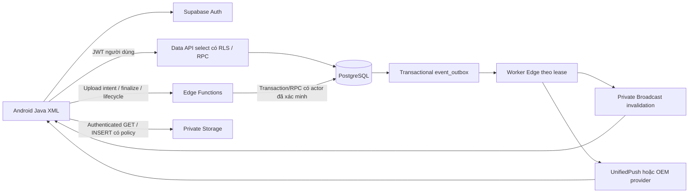

# Meeto — kiến trúc database Supabase (bản thiết kế)
Ngày: 01/11/2026. Trạng thái: **DRAFT — chưa duyệt/triển khai Supabase; nhiệm vụ04 đã kiểm DDL/RLS PostgreSQL16.11 local với stubs, chưa Supabase integration**.

## 1. Quyết định và phạm vi
Đích sau chuyển đổi: Supabase Auth + PostgreSQL + private Storage + Realtime + Edge Functions/RPC. Không còn Firebase Auth, Firestore hoặc FCM ở kiến trúc đích. Java/XML/ViewBinding được giữ; thay data/auth adapters theo từng feature sau khi được giao triển khai.

**36 bảng đề xuất**: 13 CURRENT, 6 REQUIRED, 16 FUTURE, 1 OPTIONAL. CURRENT nghĩa có dữ liệu/logic tương ứng trong Android source, **không nghĩa bảng Supabase đã tồn tại**. Auth/Storage/Realtime managed tables không tính trong36. migration_id_map là bảng vận hành tạm, không phải thêm một service runtime.

| Giai đoạn phân loại | Bảng |
|---|---|
| CURRENT (13) | profiles, friend_requests, friendships, posts, post_reactions, comments, conversations, conversation_members, messages, message_hidden, media_assets, post_media, message_media |
| REQUIRED (6) | profile_private, user_settings, account_status, user_blocks, event_outbox, migration_id_map |
| FUTURE (16) | user_follows, groups, group_members, group_join_requests, saved_posts, hidden_posts, stories, story_views, story_reactions, notifications, device_subscriptions, system_roles, reports, moderation_actions, moderation_audit, appeals |
| OPTIONAL (1) | comment_reactions |

Foundation triển khai trước chỉ phần cần parity và security; các bảng FUTURE có DDL để review quan hệ dài hạn nhưng không phải yêu cầu bật mọi feature ngay. Chưa thêm calls/video calls, ads, payments, social graph engine hoặc infrastructure phân tán. Không tạo bảng độc lập cho emoji, loại reaction, counters, last-message text, warnings hoặc mỗi provider media.

## 2. Hiện trạng được xác minh lại
Đọc baocao.txt và đối chiếu Manifest, app/build.gradle.kts, catalog, toàn bộ model/repository và data handlers trong Activity/Fragment. Đã đọc tài liệu đặc tả và text9/10 slide hai PPTX qua XML. Prefix J=app/src/main/java/com/example/meetomxh.

| Nhóm | Bằng chứng hiện hành | Hệ quả cho thiết kế |
|---|---|---|
| Auth/profile | J/RegisterActivity tạo email/phone Auth trước Users/{uid}; LoginActivity chỉ email/password; profile edit Toast | Auth làm identity authority; bootstrap profile recoverable; không copy contactVerified client thành verified Auth |
| Posts | CreatePostActivity ghi content/visibility/imageUrls/long millis; FeedRepository query desc limit30 không audience filter | Audience enforced DB; media relation; server timestamps; keyset pagination |
| Interaction | FeedRepository get reaction rồi batch increments; CommentsBottomSheetFragment batch comment/count | Idempotent set-state RPC, unique reaction, atomic counter delta |
| Friends | FriendRepository ghi2 Friends docs, accept merge không xác nhận pending | One request + one canonical friendship; pair lock/transition |
| Chat | ChatRepository deterministic pair ID, batches, server timestamps, limitToLast50; read/hidden maps | UUID conversation unique pair; membership/seq/idempotency; normalized read markers |
| Stories | FeedAdapter.initDummyStories; StoryAdapter không create/view event | FUTURE, không import dummy card làm user data |
| Groups/notification/moderation | Không có collection/API/UI implementation thực | FUTURE, phân quyền riêng từ đầu |
| Media | SupabaseStorage dùng anon key cho Bearer và public URL; SQL cũ public bucket/anon INSERT | Supabase Auth JWT thay credential request, private buckets, registry, ACL theo parent |

**Thay đổi sau báo cáo01**: local.properties hiện có hai thuộc tính Supabase có giá trị (chỉ kiểm tra tên/boolean, không đọc ra tài liệu). Điều này không chứng minh kết nối/upload thành công. Không sửa bản khảo sát cũ; bổ sung phần16 vào baocao.txt để tránh làm sai lịch sử. Không có phần15 trong báo cáo hiện có; không tự bịa nhiệm vụ02.

Workspace có source/schema draft và fixtures/mock nhưng **không có export Firestore/Auth production** được cung cấp. Không khẳng định có bao nhiêu users/posts/messages thật. Không dùng key hiện có để kết nối dự án.

## 3. Kiến trúc luồng đích

Không đưa secret/service_role key vào Android. Edge xác minh JWT bằng cơ chế Auth chính thức; không tin user_id từ JSON hoặc JWT chỉ decode không verify. Edge gọi RPC với user JWT nếu được; privileged worker chỉ có operation-scoped implementation. Không coi giữ service key ở Edge là tự động có authorization nghiệp vụ.

Không giả lập transaction bằng nhiều request Android: server transaction kết thúc trước khi gọi upload/push network. Outbox xử lý external side effect sau commit.

## 4. Auth và hồ sơ
- auth.users là nguồn identity duy nhất. profiles.id UUID PK/FK auth.users.id; metadata public nghiệp vụ tách profile_private.birth_date/gender. Email/SĐT/verification/password/session/refresh token do Supabase Auth quản lý, không thêm bảng password/session mirror.
- Bootstrap sau Auth tạo idempotently profiles + settings + account_status, theo trigger tối thiểu hoặc Edge/RPC được test; nếu bootstrap fail có retry/recovery, không cho hoạt động xã hội khi thiếu account_status/onboarding.
- complete_onboarding là RPC đặc biệt: account_ok + Auth confirmed (chưa yêu cầu onboarding_completed), validate tên/ngày sinh/tuổi phía server rồi atomically ghi profile/private fields và onboarding_completed=true. Sau đó mới upload avatar/cover tùy chọn bằng luồng media chuẩn; không mắc vòng is_active yêu cầu onboarding nhưng wizard cần upload trước. is_active của RLS có kiểm tra onboarding_completed; client không được tự PATCH cờ này.
- Email password trước; phone OTP FUTURE trong client nhưng không cần đổi schema. Không yêu cầu password giả khi phone-only. SMTP/SMS provider/deep links PKCE/reset và Android secure token storage phải thiết kế triển khai riêng.
- account_status là state authoritative mỗi truy cập; suspended/deleting bị deny xã hội kể cả JWT còn sống. is_active cần Auth confirmed email hoặc phone, không tin user_metadata.contactVerified.
- Anonymous auth accounts và anon role đều deny dữ liệu ở MVP. **Public audience = mọi user đã đăng nhập, verified, active, không block**, chưa phải guest Internet. Mở guest read sau là quyết định riêng với RLS/media tương ứng.
- Profile privacy tách visibility của “hồ sơ” khỏi audience của “bài viết”. Không suy hồ sơ private làm public post private. Last seen dùng preference riêng; Presence không thay status account.
- Xóa account là job theo giai đoạn: mark deleting/deny all + revoke sessions; chuyển admin cuối nhóm; xử lý private conversations pair FK; remove/anonymize user content theo policy; clear PII/media/push endpoints; cuối cùng Auth delete cascade profile. Không DELETE auth.users tùy tiện rồi mong cascade giải quyết mọi nghiệp vụ.

Quan hệ auth.users/profiles và rủi ro trigger signup cần kiểm tra trong staging. [Supabase User Management](https://supabase.com/docs/guides/auth/managing-user-data)

## 5. Quy tắc nghiệp vụ đích
### Bài viết/feed
- Personal: public/friends/private; group post dùng audience=group và group_id. Public group đọc được bởi active users, chỉ member active được tương tác/đăng. Private group chỉ active members. Owner không bypass ban/removal để đọc private group đã bị loại.
- Post originals/share chung bảng; share chỉ trỏ original root personal, không chain, không chia sẻ group ra ngoài MVP. Không copy body/media gốc. source mất quyền/xóa: viewer khác mất quyền share; author share chỉ thấy shell/lời bình của mình và placeholder, không được lấy source.
- Body rỗng chỉ hợp lệ nếu có ready media; RPC create_post atomically kiểm tra body/attachments/ownership. Multiple images/video/mixed: ordered post_media<=10, giai đoạn sau whitelist video/mix. Không schema field postImage đơn lẻ.
- post_reactions PK(post,user); set(type)/remove, không toggle. Counter totals đếm active rows, không tăng khi đổi reaction type. Comments nhiều cấp cùng post bằng composite FK; parent immutable; depth<=8 MVP được server kiểm tra, không giới hạn khả năng nâng sau.
- Comments deleted giữ tombstone/body=NULL để replies sống; hidden không trả row cho người thường. Posts deleted/hidden bị loại RLS. Counts trong group/block là tổng active content của đối tượng, có thể khác số viewer nhìn thấy; nếu không muốn lộ aggregates của người bị block thì presentation trả viewer-filtered counts qua RPC.
- Saved/hidden là preference riêng, không thêm quyền. Feed keyset(created_at,id), descending, page20/max50; filter audience/group/block ở DB. Feed friend dùng EXISTS friendship; following không cấp quyền friends. Không precompute fan-out feed trước khi đo.

### Quan hệ
- Pair least/greatest(UUID) ổn định. friendship one row/cặp. friend_requests giữ direction, terminal status và request idempotency; partial unique pending pair.
- Gửi chéo: request thứ2 nhận “incoming_request_exists” + ID pending, **không auto-accept**. Recipient phải gọi accept. Accept nonpending/nonexistent/blocked -> conflict/deny, retry đúng request accepted còn friendship -> same result, accepted cũ sau unfriend không tự tạo lại.
- Block trong pair-lock: tạo block, cancel pending requests, remove friendship và follows hai chiều; no new DM/send/reaction giữa cặp. Unblock không khôi phục quan hệ.
- Shared community/group chat: block không tự kick cả người dùng; ẩn nội dung cá nhân từ người bị block; metadata membership tối thiểu vẫn cần cho quản trị nhóm. Đây là ngoại lệ có chủ đích cần duyệt, không hứa “không bao giờ biết người kia tồn tại”.

### Nhóm
- group_members role=admin/moderator/member là scope riêng, không system_roles. Join private qua request, approve transaction; banned không join lại. Public join trực tiếp bằng RPC.
- Lock group row trước mọi change role/membership. Group active luôn >=1 active admin; admin cuối leave/demote bị reject trừ transfer atomically hoặc archive/delete group được phép. Delete Auth account phải đi qua cùng guard.
- Archive: read-only cho members, không post/join mới; **bản helper RLS SQL hiện fail-closed với archived**, cần endpoint archive read riêng nếu sản phẩm duyệt. Không vô tình cấp read vì “state khác deleted”.
- Group Admin xử lý membership/nội dung nhóm theo quyền, không xem private messages/profile_private và không gán system role.

### Chat
- Một bảng conversations cho private/group. Private unique(direct_low,direct_high) WHERE kind=private; get_or_create_private transaction tạo exactly2 immutable member rows. Không lưu receiver trên mọi message.
- Conversation row lock cấp seq next_seq+1, đảm bảo thứ tự commit trong conversation. messages unique(conversation,seq), idempotency unique(conversation,sender,client_request_id).
- Client lưu UUID request vào local pending queue trước send, retry cùng UUID và payload. Server canonical-hash nội dung/type/reply/assets: request cũ same hash -> return same ID; different hash ->409. request_hash không được select/publication vì hash text ngắn đã recall có thể bị đoán.
- Member mới group chat: history_from_seq=next_seq+1 ở transaction join; default **không đọc lịch sử trước join**. Leave/remove -> mất toàn bộ quyền chat kể cả URL media. Rejoin reset boundary. Lưu nhiều đợt membership lịch sử chỉ khi yêu cầu khác được duyệt; chưa thêm bảng sessions membership.
- Read markers seq monotonic, max<=last existing authorized incoming visible seq; advance delivered>=read. Delivered chỉ ACK client thật, không coi DB commit là delivered. No table per-message-receipt tới khi yêu cầu analytics.
- messages reply FK composite cùng conversation; quote đọc nguồn hiện tại, không persist plaintext snapshot. Story replies gửi chat private qua cùng send RPC, kiểm tra author/story/access lúc gửi; story expired sau này quote chỉ hiển thị placeholder.
- Recall tombstone body=NULL, disabled media cùng transaction, generic invalidation; deleteForMe chỉ message_hidden(user,message), RLS raw message/media cũng deny user đó. Không chỉ ẩn trên Android.
- Inbox không giữ lastMessage text. last_message_id là hint; inbox RPC chọn tin mới nhất **visible theo từng member**, membership-boundary/hidden/block/recall. Không đọc sender preview từ pointer chung.

### Stories
- FUTURE, một media asset/story. expires_at=created_at+24h server; active query/RLS đều now()<expires_at. Không phụ thuộc cron để bảo vệ expiry.
- Expired không phải deleted: trạng thái expired suy theo timestamp; state deleted do owner/moderation, archived owner-only nếu bật sản phẩm. Không tự archive mặc định.
- record_view unique(story,viewer); reactions một row/user; replies dùng messages.reply_story_id. Expiry đang xem: API/media request mới bị deny, UI timer đóng player, bytes đã tải không thu hồi được.
- Cleanup job riêng asset lifecycle; không coi mất khỏi list là đã xóa file.

### Notifications/moderation
- event_outbox ghi cùng transaction source; worker tạo notification unique(recipient,event_key) sau kiểm tra preferences/block/access, rồi push. Đưa mỗi loại event friend/comment/reply/share/story/group/chat/moderation vào catalog, không trigger client tạo tùy ý.
- Notification chứa type/target ID, không snapshot text/ảnh; lúc click query lại quyền, deleted/inaccessible -> unavailable.
- reports có typed target FK, assignment, state machine. Moderator chỉ case assigned; system admin triage case metadata không mặc nhiên có quyền đọc mọi private content. report_context RPC trả đúng evidence được phép, audit.
- User không update system_roles, account_status, assigned_to hoặc counters. Moderation action (hide/remove/warn/suspend/restore) tx case+target+audit+event; Group Admin chỉ action group được ủy quyền. Appeal FUTURE, locked account dùng support Edge endpoint giới hạn, không mở database xã hội.

## 6. Ranh giới consistency và hợp đồng API
Bảng dưới là **hợp đồng cần triển khai sau**, không phải những RPC đã có. SQL draft cung cấp DDL/RLS/helper đọc; không có RPC write triển khai hoàn chỉnh và không grant DML nghiệp vụ để tránh “tưởng đã bảo vệ”.

| Operation | Transaction/lock và invariant | Retry/result |
|---|---|---|
| bootstrap_profile/update_profile/private | caller=JWT; active/verified theo phase; validate name/age>=13/calendar; owned ready assets đúng purpose; server timestamps/version | auth UID unique; update expected_version conflict |
| send/accept/decline/cancel friend, unfriend, block/unblock, follow | advisory xact pair lock cho cả2 UID; recheck block/active; pending+friendship transition + outbox cùng tx | request UUID; action terminal idempotent, stale transition409 |
| create/edit/share/delete post | lock author pair nếu source relation cần; lock post/source ổn định; visibility/group/member recheck; assets owned; version; actual counters/outbox | client_request_id unique; same request returns ID; delete same target no extra delta |
| set_post_reaction | pair author-viewer lock nếu khác; lock post FOR UPDATE; recheck permission; INSERT/UPDATE/DELETE; counter delta chỉ khi cardinality đổi | natural PK+explicit desired state |
| create/edit/delete comment | lock post trước comment; same-post parent/depth; state/version; count change/outbox | create UUID; deleted again no decrement |
| join/approve/leave/kick/ban/transfer group | lock group trước membership; last-admin guard; roles; outbox | pending partial unique; explicit desired state/version |
| get_or_create_private / manage group chat | private pair lock rồi conversation row; group membership role changes conversation lock; exactly2 private rows | unique pair ON CONFLICT; group request UUID |
| send_message | pair lock private peers rồi conversation lock; membership/block/read boundary recheck; allocate seq; insert+media+summary+outbox | same UUID/hash ->same ID; reuse UUID khác hash409 |
| mark_read / delivery ACK | conversation then member row lock; actor=current member; referenced seq visible<=next_seq; greatest(old,new) | monotonic max, read implies delivered |
| recall_message / hide_message | pair lock(private) ->conversation ->message; sender/member; same tx body/state/media, summary version,outbox | natural target+desired state; recall again same tombstone |
| record_story_view/reaction/delete/expiry archive | story/asset lock; expiry at transaction boundary checked server; actor/viewer; unique constraint | UPSERT/no-op; delete doesn't resurrect |
| prepare_upload/finalize/attach/cleanup | registry reservation; Storage API outside tx; finalize verify bytes/status; link parent only in tx | asset UUID; immutable paths; orphan grace24h |
| mark_notifications_read | owner IDs only, server now(), <=100 IDs, no assignment/recipient update | set once or same timestamp |
| register/revoke device | Edge authenticates actor, validates endpoint not SSRF, upsert installation; no user-supplied recipient | installation ID+owner; rotate/rebind on account switch |
| report/assign/apply_moderation/appeal | server checks actual system role+assignment+scope; lock case/target; version/idempotency; immutable audit | client UUID/action UUID; conflicting resolution409 |
| request/delete account | mark deleting + outbox; phased worker and reconciliation; final Auth Admin API not raw client SQL | durable job key; resumable stages |

**Lock order**: one pair advisory xact lock (canonical UUID pair) before conversation/group/post parent locks; parent before child; multiple parent IDs sorted ascending. Block RPC cùng lock private-send/friend/follow. Group roles serialized on group; chat members serialized on conversation. Với reaction/comment ở personal Friends post, pair lock với author + post lock, unfriend/block dùng cùng pair key nên quyền được xét theo điểm serialize. Member removal và group-post mutation cùng group lock trước post; group membership reads RLS deny tại request mới ngay khi commit. Request bắt đầu trước block commit có thể hoàn tất theo điểm linearization trước block; không hứa hủy request đã gửi bytes.

Đối với plain SELECT quyền là snapshot của statement, không khóa toàn bộ social graph. Backend không thể thu hồi response đã gửi hoặc dữ liệu người dùng đã sao chép.

- Không dùng CHECK truy vấn bảng khác; FK/UNIQUE/CHECK xử lý row/relational keys, RPC xử lý state cross-row. [PostgreSQL constraints](https://www.postgresql.org/docs/current/ddl-constraints.html)
- Lock transaction được chọn để serialize chuyển trạng thái trên đối tượng, không dùng session lock pooler; retry bounded SQLSTATE40001/40P01 với cùng idempotency key. [PostgreSQL locking](https://www.postgresql.org/docs/18/explicit-locking.html)
- Counter writer chọn **một nguồn duy nhất**: RPC update atomic delta, không đồng thời trigger cùng counter. Direct DML denied; maintenance/import cũng gọi reconcile. Account cascade có thể xóa reaction ngoài RPC nên purge job recompute parent totals; đếm lại audit theo lịch cho drift.
- Outbox exactly-once DB insertion qua unique key; external delivery **at-least-once**, không tuyên bố exactly-once push.

## 7. Hiệu năng/MVP
Giả định để sizing, không phải số liệu production: <=10.000 account, <=500 DAU, <=100 concurrent sockets, <=1 triệu messages trước khi đánh giá lại. One Supabase project/Postgres; không sharding/Redis/Kafka.
- Feed20/max50; users20/max50 prefix lower(display_name) indexed; comment roots20 + reply cursor; chat50/max100 seq cursor; notifications20/max50; không offset pagination cho timeline.
- Query feed join profiles/assets/reactions của caller theo batch (page IDs), không N+1 mỗi post. Trả projections rõ, không SELECT * mọi profile/asset.
- Indexes có trong DDL: author/group/created_at,id; normalized pair hai chiều; conversation seq; membership user/state; notification recipient/time; worker due leases.
- Search user: lower prefix, chưa bỏ dấu; muốn unaccent/trigram phải duyệt extension/index và collation. Message FTS simple + GIN partial state=sent/type=text; query luôn conversation membership+history boundary, không expose search global raw. Đọc nội dung post FTS tương lai cùng RLS; chưa tạo bảng search engine riêng.
- RLS predicates có index tồn tại; helper bypass recursion chỉ boolean actor-bound. EXPLAIN(ANALYZE,BUFFERS) dưới authenticated JWT staging với graph giả lập là gate; chưa đo latency. Cap list counts và response; không dùng helper lặp theo mỗi attachment không giới hạn.
- Counters gây hot post/conversation row: phù hợp MVP; khi lock contention đo được mới chuyển aggregation async/batched, tách sequencer/partition theo thật sự cần. seq per-conversation khác UUID không trông vào UUID sorting.
- Media dominant growth: MIME/size server, quotas per-user/day, compression/thumbnails staging, cleanup/reconcile Storage, retention. TTL không dùng partial index now() vì predicate động; index expires_at thông thường.
- Realtime không publish toàn schema hoặc bảng có request_hash, không full payload PII; invalidation + query back RLS; coalesce events theo user, reconnect backfill.
- Retention đề xuất cần duyệt: unbound upload24h; pending upload intent15min; terminal friend requests90d; notification90d; delivered outbox7d, dead30d; audit180d; recycle tombstone30d (messages recall body xóa ngay, chỉ metadata tùy conversation retention); migration mappings tới rollback+30d. Không cron nào được tạo lúc thiết kế.

## 8. Các tradeoff cần duyệt
1. Public chỉ logged-in; toàn bộ4 buckets private, kể cả avatar/cover, tốn authenticated image loads nhưng hỗ trợ block/privacy.
2. Member mới chat không đọc lịch sử; rời nhóm mất toàn bộ lịch sử, phù hợp deny-by-default nhưng khác một số messenger.
3. Block không tách khỏi nhóm chung; không thể che tuyệt đối metadata thành viên đồng nhóm.
4. Share source unavailable -> không đọc source; author shell giữ lời bình. Group-to-public share chưa bật.
5. Không dùng signed URLs cho confidential media mặc định vì bearer URL có cửa sổ quyền còn lại; authenticated GET/proxy là chuẩn.
6. Push không FCM qua UnifiedPush/OEM cần thành phần phân phối/thiết bị và vận hành; chưa cam kết trải nghiệm nền tương đương mọi máy.
7. Quyết định purge private conversation khi xóa account do FK pair RESTRICT cần chủ dự án duyệt; nếu muốn người còn lại giữ lịch sử phải làm pseudonymous identity/tombstone mapping riêng trước migration.
8. Draft chưa đủ chạy ứng dụng: mọi RPC mutation, worker, bootstrap, jobs, bucket config và client adapter là công việc sau duyệt.

Xem DICTIONARY cho36 bảng/constraints/CRUD; RLS_DESIGN cho ma trận; STORAGE_REALTIME cho giới hạn platform; MIGRATION cho rollback; DESIGN_REVIEW cho18 tình huống.

## 9. Kiểm chứng và điều chỉnh nhiệm vụ04
DDL và21 authorization helpers/RLS đã chạy trên PostgreSQL16.11 local với Auth/Storage/Realtime stubs;99 assertion và3 concurrency patterns đã qua, chưa phải Supabase integration/RPC pass. Giữ36 bảng/267 cột; báo cáo mới ở MEETO_PRE_IMPLEMENTATION_AUDIT.md, baocao.txt giữ nguyên.
- Story asset UNIQUE; notification_preferences<=4096 byte, key whitelist và boolean values trong DB; không dựa API validation trong khi còn direct settings UPDATE.
- Media read ACL bổ sung purpose+owner tương ứng parent, không chỉ thấy một FK reference là cho đọc.
- App migration owner global default PUBLIC EXECUTE bị revoke; scope theo owner, không có tác dụng “IN SCHEMA” để gỡ default toàn cục. Các helper được grant tường minh.
- ERD sửa4 cạnh FOREIGN giả do parsing composite FK, còn79 quan hệ thực và nullability/cardinality đã chỉnh.
- Full SQL helper graph tham chiếu nhiều module FUTURE. Roadmap A0 bootstraps36 inert tables trong staging/approved new baseline, chỉ enable feature API/grants theo A–E; không chạy một phần full helper bundle khi thiếu bảng.
- Admin membership cuối khác admin có thể hoạt động sau suspend; cần duyệt archive/transfer staff workflow trước phaseE. Không tự cấp System Admin cho Group Admin.
- Danh mục47 nhóm operation phải lập trình: MEETO_RPC_IMPLEMENTATION_CATALOG.md. Chưa có body mutation RPC trong draft, không mở quyền ghi để né.

## Implementation nhiệm vụ 05
Mã migration/RPC Phase A đã được tạo riêng ở supabase/migrations; snapshot SQL thiết kế giữ guard. Bootstrap trigger + recovery, onboarding/profile/private/settings/block và8 public RPC kiểm trên PostgreSQL local với stubs; chưa Supabase stack/staging, chưa Android/cutover. Target profile của người khác phải completed (migration003); không expose pending placeholder. Function/default ACL phase A đóng future grants cả table/cột. Xem MEETO_PHASE_A_IMPLEMENTATION.md cho mã đã thực hiện,87 assertions,3 RPC races và service integration còn BLOCKED.