# Meeto — ERD PostgreSQL
DRAFT;36 bảng ứng dụng/vận hành, chưa tạo trên database. auth_users là auth.users managed, không tính36. Sơ đồ chỉ hiện PK/FK và vài field ngữ nghĩa; toàn bộ cột/UNIQUE/CHECK/index xem dictionary và SQL. Quan hệ optional theo nullability; cardinality1:1 còn phụ thuộc UNIQUE/PK trong DDL.

```mermaid
erDiagram
  auth_users {
    uuid id PK
  }
  profiles {
    uuid id PK, FK
    uuid avatar_asset_id FK
    uuid cover_asset_id FK
  }
  profile_private {
    uuid user_id PK, FK
  }
  user_settings {
    uuid user_id PK, FK
  }
  account_status {
    uuid user_id PK, FK
    text state
  }
  user_blocks {
    uuid blocker_id PK, FK
    uuid blocked_id PK, FK
  }
  user_follows {
    uuid follower_id PK, FK
    uuid followed_id PK, FK
  }
  friend_requests {
    uuid id PK
    uuid requester_id FK
    uuid recipient_id FK
    text state
  }
  friendships {
    uuid user_low PK, FK
    uuid user_high PK, FK
  }
  groups {
    uuid id PK
    uuid created_by FK
    text state
    uuid cover_asset_id FK
  }
  group_members {
    uuid group_id PK, FK
    uuid user_id PK, FK
    text state
  }
  group_join_requests {
    uuid id PK
    uuid group_id FK
    uuid user_id FK
    text state
    uuid reviewed_by FK
  }
  posts {
    uuid id PK
    uuid author_id FK
    uuid group_id FK
    text kind
    uuid original_post_id FK
    text audience
    text state
  }
  post_reactions {
    uuid post_id PK, FK
    uuid user_id PK, FK
  }
  comments {
    uuid id PK
    uuid post_id FK
    uuid author_id FK
    uuid parent_id FK
    text state
  }
  comment_reactions {
    uuid comment_id PK, FK
    uuid user_id PK, FK
  }
  saved_posts {
    uuid user_id PK, FK
    uuid post_id PK, FK
  }
  hidden_posts {
    uuid user_id PK, FK
    uuid post_id PK, FK
  }
  stories {
    uuid id PK
    uuid author_id FK
    uuid media_asset_id FK
    text audience
    text state
  }
  story_views {
    uuid story_id PK, FK
    uuid viewer_id PK, FK
  }
  story_reactions {
    uuid story_id PK, FK
    uuid user_id PK, FK
  }
  conversations {
    uuid id PK
    text kind
    uuid direct_low FK
    uuid direct_high FK
    uuid created_by FK
    text state
    uuid last_message_id FK
  }
  conversation_members {
    uuid conversation_id PK, FK
    uuid user_id PK, FK
    text state
    bigint history_from_seq
  }
  messages {
    uuid id PK
    uuid conversation_id FK
    bigint seq
    uuid sender_id FK
    text kind
    uuid reply_to_message_id FK
    uuid reply_story_id FK
    text state
  }
  message_hidden {
    uuid message_id PK, FK
    uuid conversation_id FK
    uuid user_id PK, FK
  }
  media_assets {
    uuid id PK
    uuid owner_id FK
    text state
  }
  post_media {
    uuid post_id PK, FK
    uuid asset_id PK, FK
  }
  message_media {
    uuid message_id PK, FK
    uuid asset_id PK, FK
  }
  notifications {
    uuid id PK
    uuid recipient_id FK
    uuid actor_id FK
    text kind
  }
  device_subscriptions {
    uuid id PK
    uuid user_id FK
    text state
  }
  event_outbox {
    uuid id PK
    text state
  }
  system_roles {
    uuid user_id PK, FK
    text role PK
    uuid granted_by FK
  }
  reports {
    uuid id PK
    uuid reporter_id FK
    uuid post_id FK
    uuid comment_id FK
    uuid story_id FK
    uuid message_id FK
    uuid profile_id FK
    uuid group_id FK
    text state
    uuid assigned_to FK
  }
  moderation_actions {
    uuid id PK
    uuid report_id FK
    uuid actor_id FK
  }
  moderation_audit {
    uuid id PK
    uuid actor_id FK
    uuid action_id FK
    uuid report_id FK
  }
  appeals {
    uuid id PK
    uuid action_id FK
    uuid appellant_id FK
    text state
    uuid assigned_to FK
  }
  migration_id_map {
    text source_system PK
    text entity_type PK
    text legacy_id PK
  }
  auth_users ||--o| profiles : "id"
  media_assets |o--o{ profiles : "avatar_asset_id"
  media_assets |o--o{ profiles : "cover_asset_id"
  profiles ||--o| profile_private : "user_id"
  profiles ||--o| user_settings : "user_id"
  profiles ||--o| account_status : "user_id"
  profiles ||--o{ user_blocks : "blocker_id"
  profiles ||--o{ user_blocks : "blocked_id"
  profiles ||--o{ user_follows : "follower_id"
  profiles ||--o{ user_follows : "followed_id"
  profiles ||--o{ friend_requests : "requester_id"
  profiles ||--o{ friend_requests : "recipient_id"
  profiles ||--o{ friendships : "user_low"
  profiles ||--o{ friendships : "user_high"
  profiles |o--o{ groups : "created_by"
  media_assets |o--o{ groups : "cover_asset_id"
  groups ||--o{ group_members : "group_id"
  profiles ||--o{ group_members : "user_id"
  groups ||--o{ group_join_requests : "group_id"
  profiles ||--o{ group_join_requests : "user_id"
  profiles |o--o{ group_join_requests : "reviewed_by"
  profiles |o--o{ posts : "author_id"
  groups |o--o{ posts : "group_id"
  posts |o--o{ posts : "original_post_id"
  posts ||--o{ post_reactions : "post_id"
  profiles ||--o{ post_reactions : "user_id"
  posts ||--o{ comments : "post_id"
  profiles |o--o{ comments : "author_id"
  comments |o--o{ comments : "parent_id,post_id"
  comments ||--o{ comment_reactions : "comment_id"
  profiles ||--o{ comment_reactions : "user_id"
  profiles ||--o{ saved_posts : "user_id"
  posts ||--o{ saved_posts : "post_id"
  profiles ||--o{ hidden_posts : "user_id"
  posts ||--o{ hidden_posts : "post_id"
  profiles |o--o{ stories : "author_id"
  media_assets ||--o| stories : "media_asset_id"
  stories ||--o{ story_views : "story_id"
  profiles ||--o{ story_views : "viewer_id"
  stories ||--o{ story_reactions : "story_id"
  profiles ||--o{ story_reactions : "user_id"
  profiles |o--o{ conversations : "direct_low"
  profiles |o--o{ conversations : "direct_high"
  profiles |o--o{ conversations : "created_by"
  messages |o--o| conversations : "last_message_id"
  conversations ||--o{ conversation_members : "conversation_id"
  profiles ||--o{ conversation_members : "user_id"
  conversations ||--o{ messages : "conversation_id"
  profiles |o--o{ messages : "sender_id"
  stories |o--o{ messages : "reply_story_id"
  messages |o--o{ messages : "reply_to_message_id,conversation_id"
  messages ||--o{ message_hidden : "message_id,conversation_id"
  conversation_members ||--o{ message_hidden : "conversation_id,user_id"
  profiles |o--o{ media_assets : "owner_id"
  posts ||--o{ post_media : "post_id"
  media_assets ||--o{ post_media : "asset_id"
  messages ||--o{ message_media : "message_id"
  media_assets ||--o{ message_media : "asset_id"
  profiles ||--o{ notifications : "recipient_id"
  profiles |o--o{ notifications : "actor_id"
  profiles ||--o{ device_subscriptions : "user_id"
  profiles ||--o{ system_roles : "user_id"
  profiles |o--o{ system_roles : "granted_by"
  profiles |o--o{ reports : "reporter_id"
  posts |o--o{ reports : "post_id"
  comments |o--o{ reports : "comment_id"
  stories |o--o{ reports : "story_id"
  messages |o--o{ reports : "message_id"
  profiles |o--o{ reports : "profile_id"
  groups |o--o{ reports : "group_id"
  profiles |o--o{ reports : "assigned_to"
  reports ||--o{ moderation_actions : "report_id"
  profiles |o--o{ moderation_actions : "actor_id"
  profiles |o--o{ moderation_audit : "actor_id"
  moderation_actions |o--o{ moderation_audit : "action_id"
  reports |o--o{ moderation_audit : "report_id"
  moderation_actions ||--o{ appeals : "action_id"
  profiles |o--o{ appeals : "appellant_id"
  profiles |o--o{ appeals : "assigned_to"
```

## Ràng buộc không thể hiện hết bằng mũi tên
- profiles.id và profile_private/settings/account_status.user_id là0..1 extension row mỗi Auth user; PK/FK làm cardinality thực tế1:1, bootstrap bảo đảm đủ rows.
- friendship canonical ordered pair; friend_requests unique partial pending pair; direct chat unique private pair (low,high). Không có “hai dòng hai phía”.
- comments(parent_id,post_id) -> comments(id,post_id): cùng post, parent bất biến; reply_to_message_id+conversation_id -> messages cùng conversation.
- conversations(last_message_id,id) -> messages(id,conversation_id): cùng conversation, FK deferred; pointer không chứa text preview và không thay per-viewer inbox query.
- media relation còn phải match purpose/owner/ready ở RPC. profiles -> media_assets -> owner profiles tạo cycle có chủ đích, tạo FK avatar/cover sau tables; không circular INSERT bắt buộc vì ảnh optional.
- stories.media_asset_id NOT NULL tạo sau media registry theo workflow. Post/media và message/media<=10 có UNIQUE vị trí và asset singleton mỗi bảng; cấm reuse cross-context qua purpose/attach RPC.
- notifications.target_type/target_id, event_outbox.aggregate và migration_id_map.new_id là polymorphic reference đã chủ đích không vẽ FK giả. Typed reports FK có thể null sau purge, nhưng đúng1 target khi submit.
- Một conversation có exactly2 members khi private; group>=2 khi tạo và >=1 admin khi active. Đây là transaction invariant, ERD không tự bảo đảm cardinality có điều kiện.
- system_roles khác group_members.role và conversation_members.role: ba phạm vi quyền riêng biệt.

